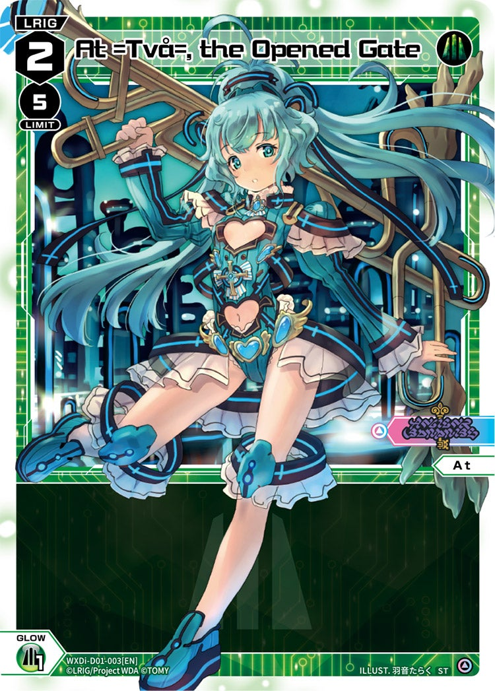

# At =Tv?=, the Opened Gate

## Th?ng tin l?

| Tr??ng | Gi? tr? |
| --- | --- |
| M? in | WXDi-D01-003[EN] |
| Set | WXDi-D01[EN] |
| Lo?i th? | LRIG |
| V? tr? | LRIG Deck |
| S? b?n D01 | 1 |
| M?u | Xanh l? |
| ?? hi?m | ST,SCR |
| Minh h?a | 羽音たらく |
| Level | 2 |
| Limit | 5 |
| Power | 0 |
| LRIG type / Class | At |
| Team / Master | Ancient Surprise |
| Cost | ? |
| Grow cost | 《G》×１ |
| Use timing | ? |
| Life Burst | Kh?ng |

## Card text ch?nh th?c

?

## Power text / Life Burst

?

## Ghi ch? minh h?a
Artist: 羽音たらく. ?nh ST ???c t?i t? Card List ti?ng Anh.
## ?nh bi?n th?

- [SCR](../images/WXDi-D01-003S-EN.jpg)

## Ngu?n
[Card List/FAQ ch?nh th?c](https://www.takaratomy.co.jp/products/en.wixoss/card/card.html?card_no=WXDi-D01-003%5BEN%5D) ? [?nh th?](https://www.takaratomy.co.jp/products/en.wixoss/card/thumb/WXDi-D01-003%5BEN%5D.jpg)
