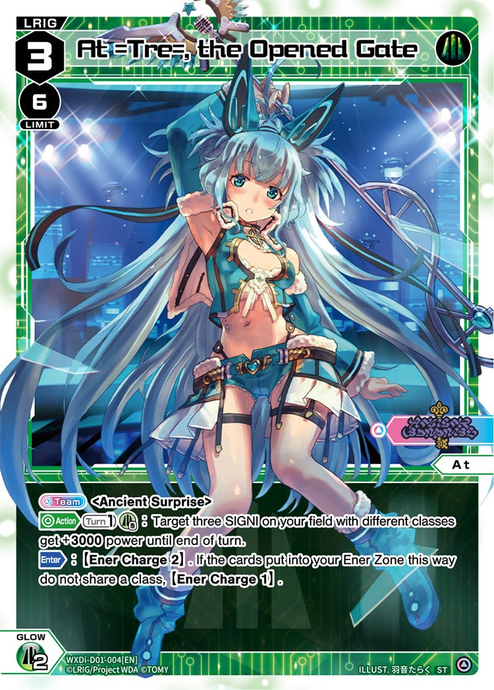

# At =Tre=, the Opened Gate

## Th?ng tin l?

| Tr??ng | Gi? tr? |
| --- | --- |
| M? in | WXDi-D01-004[EN] |
| Set | WXDi-D01[EN] |
| Lo?i th? | LRIG |
| V? tr? | LRIG Deck |
| S? b?n D01 | 1 |
| M?u | Xanh l? |
| ?? hi?m | ST,SCR,DiR |
| Minh h?a | 羽音たらく |
| Level | 3 |
| Limit | 6 |
| Power | 0 |
| LRIG type / Class | At |
| Team / Master | Ancient Surprise |
| Cost | ? |
| Grow cost | 《G》×２ |
| Use timing | ? |
| Life Burst | Kh?ng |

## Card text ch?nh th?c

[Team] <Ancient Surprise>

[Team Action] {1/Turn} {Greenx0}: Target three SIGNI on your field with different classes get +3000 power until end of turn.

[Enter]: 【Ener Charge 2】. If the cards put into your Ener Zone this way do not share a class, 【Ener Charge 1】.

## Power text / Life Burst

?

## Ghi ch? minh h?a
Artist: 羽音たらく. ?nh ST ???c t?i t? Card List ti?ng Anh.

## FAQ ch?nh th?c

**Q. What does it mean by [Team]?**
A. It means the team indicated by that card. The [Team Auto], [Team Action], [Team Constant], and [Team Enter] abilities of the card are valid only if all 3 LRIGs in your field are the indicated [Team].

In the case of this card, if all three of your LRIGs are <ANCIENT SURPRISE>, you will be able to use the [Team Action] ability.

**Q. Can this [Team Action] ability use to target one or two SIGNI ?**
A. No, you can't in this case. This card's text doesn't say "up to three", so you need to have three appropriate targets.

**Q. What if one or both of the cards placed in the Ener zone by the [Enter] ability are Spell Cards?**
A. You can do additional 【Ener Charge 1】. Spell card has no class. In this case, the first two cards revealed are treated as if they have no class in common.

## ?nh bi?n th?

- [SCR](../images/WXDi-D01-004S-EN.jpg)
- [DiR](../images/WXDi-D01-004D-EN.jpg)

## Ngu?n
[Card List/FAQ ch?nh th?c](https://www.takaratomy.co.jp/products/en.wixoss/card/card.html?card_no=WXDi-D01-004%5BEN%5D) ? [?nh th?](https://www.takaratomy.co.jp/products/en.wixoss/card/thumb/WXDi-D01-004%5BEN%5D.jpg)
