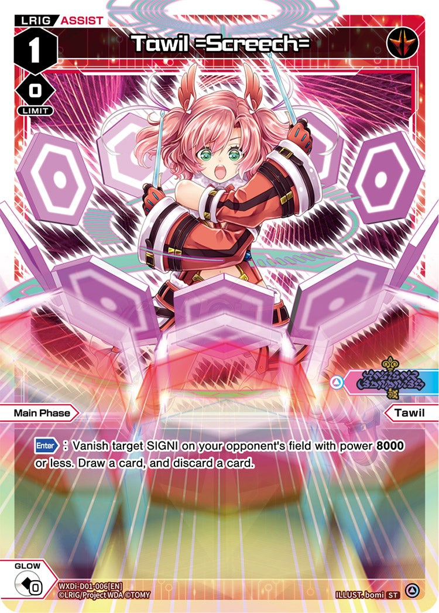

# Tawil =Screech=

## Thông tin lá

| Trường | Giá trị |
| --- | --- |
| Mã in | WXDi-D01-006[EN] |
| Set | WXDi-D01[EN] |
| Loại thẻ | ASSIST LRIG |
| Vị trí | LRIG Deck |
| Số bản D01 | 1 |
| Màu | Đỏ |
| Độ hiếm | ST |
| Minh họa | bomi |
| Level | 1 |
| Limit | 0 |
| Power | 0 |
| LRIG type / Class | Tawil |
| Team / Master | Ancient Surprise |
| Cost | — |
| Grow cost | 《C》×０ |
| Use timing | Main Phase |
| Life Burst | Không |

## Card text chính thức

[Enter]: Vanish target SIGNI on your opponent's field with power 8000 or less. Draw a card, and discard a card.

## Power text / Life Burst

—

## Ghi chú minh họa
Artist: bomi. Ảnh ST được tải từ Card List tiếng Anh.

## FAQ chính thức

**Q. Can I draw a card even if my opponent has no SIGNI with power less than 8000?**
A. Yes, you can. If there is no appropriate target, as in this case, the latter effect will still be processed.

## Nguồn
[Card List/FAQ chính thức](https://www.takaratomy.co.jp/products/en.wixoss/card/card.html?card_no=WXDi-D01-006%5BEN%5D ) · [Ảnh thẻ](https://www.takaratomy.co.jp/products/en.wixoss/card/thumb/WXDi-D01-006%5BEN%5D.jpg)
