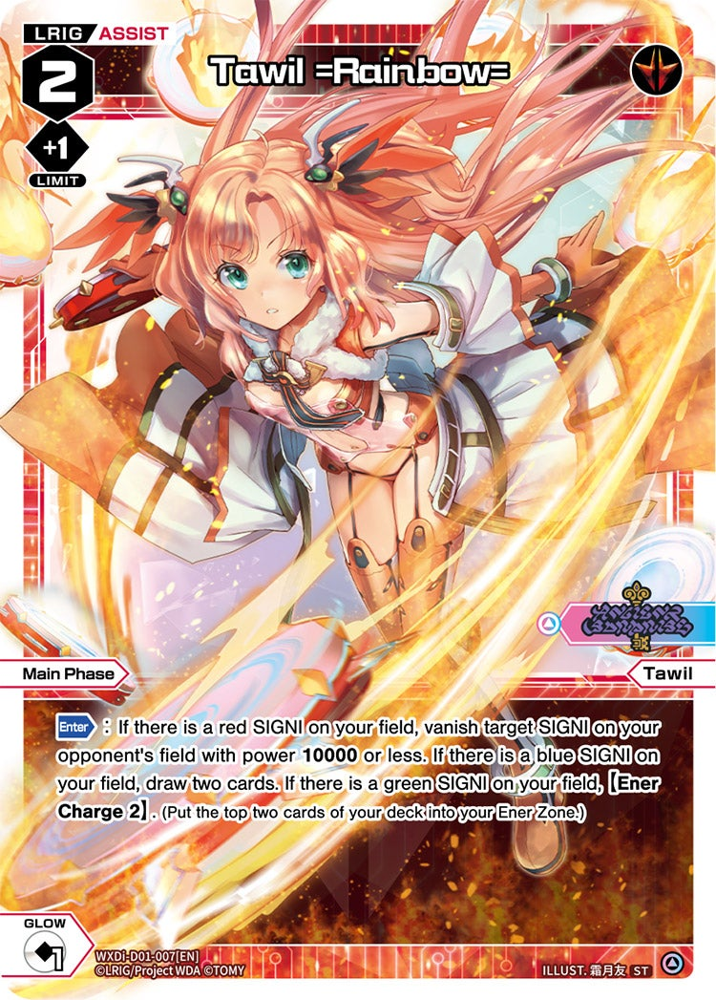

# Tawil =Rainbow=

## Thông tin lá

| Trường | Giá trị |
| --- | --- |
| Mã in | WXDi-D01-007[EN] |
| Set | WXDi-D01[EN] |
| Loại thẻ | ASSIST LRIG |
| Vị trí | LRIG Deck |
| Số bản D01 | 1 |
| Màu | Đỏ |
| Độ hiếm | ST |
| Minh họa | 霜月友 |
| Level | 2 |
| Limit | ＋１ |
| Power | 0 |
| LRIG type / Class | Tawil |
| Team / Master | Ancient Surprise |
| Cost | — |
| Grow cost | 《C》×１ |
| Use timing | Main Phase |
| Life Burst | Không |

## Card text chính thức

[Enter]: If there is a red SIGNI on your field, vanish target SIGNI on your opponent's field with power 10000 or less. If there is a blue SIGNI on your field, draw two cards. If there is a green SIGNI on your field, 【Ener Charge 2】. (Put the top two cards of your deck into your Ener Zone.)

## Power text / Life Burst

—

## Ghi chú minh họa
Artist: 霜月友. Ảnh ST được tải từ Card List tiếng Anh.

## FAQ chính thức

**Q. There are red, blue, and green SIGNI in my each SIGNI ZONE. Can I use each effect of this card?**
A. Yes, each conditions have been met and all effects can be used. From the top, process "vanish"," "draw," and "【Ener Charge 2】" in that order.

**Q. If I use this LRIG when I have only 3 cards left in my Main deck, how are the draw and energy charge effects processed?**
A. In this case, first draw two cards, then process 【Ener Charge 2】.

When the first card is placed in your Ener zone, your deck is reduced to zero, and the effect ends without placing the second card into your Ener zone.

Then, refresh your Main deck.

**Q. There are only one 《Water Buffalo, Phantom Aquatic Beast》 is in my SIGNI ZONE. How is this [Enter] ability processed?**
A. In this case, this [Enter] ability will be processed as if there is a blue and green SIGNI.

You can draw and 【Ener Charge 2】.

## Nguồn
[Card List/FAQ chính thức](https://www.takaratomy.co.jp/products/en.wixoss/card/card.html?card_no=WXDi-D01-007%5BEN%5D ) · [Ảnh thẻ](https://www.takaratomy.co.jp/products/en.wixoss/card/thumb/WXDi-D01-007%5BEN%5D.jpg)
