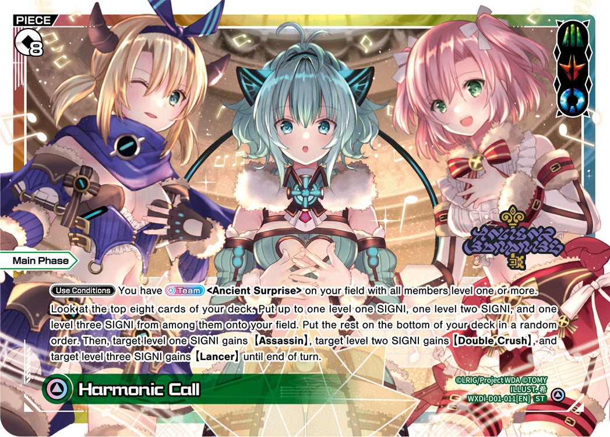

# Harmonic Call

## Th?ng tin l?

| Tr??ng | Gi? tr? |
| --- | --- |
| M? in | WXDi-D01-011[EN] |
| Set | WXDi-D01[EN] |
| Lo?i th? | PIECE |
| V? tr? | LRIG Deck |
| S? b?n D01 | 1 |
| M?u | Xanh l? / ?? / xanh d??ng |
| ?? hi?m | ST,DiR |
| Minh h?a | 希 |
| Level | ? |
| Limit | ? |
| Power | 0 |
| LRIG type / Class | ? |
| Team / Master | ? |
| Cost | 《C》×８ |
| Grow cost | ? |
| Use timing | Main Phase |
| Life Burst | Kh?ng |

## Card text ch?nh th?c

[Use Conditions] You have [Team] <Ancient Surprise> on your field with all members level one or more.

Look at the top eight cards of your deck. Put up to one level one SIGNI, one level two SIGNI, and one level three SIGNI from among them onto your field. Put the rest on the bottom of your deck in a random order. Then, target level one SIGNI gains 【Assassin】, target level two SIGNI gains 【Double Crush】, and target level three SIGNI gains 【Lancer】 until end of turn.

## Power text / Life Burst

?

## Ghi ch? minh h?a
Artist: 希. ?nh ST ???c t?i t? Card List ti?ng Anh.

## FAQ ch?nh th?c

**Q. Can I target a SIGNI other than the SIGNI that was put by the effect of this PIECE to give an ability of [Assassin],[Double Crush], and or [Lancer]?**
A. Yes, you can. It is possible to give an ability to a SIGNI that was in your SIGNI ZONE before using PIECE, as long as the condition (LEVEL in this case) is met.

**Q. I used this PIECE to put 3 SIGNI on the field. If they all have [Enter] Ability, how will they be activated?**
A. Triggered abilities such as [Enter] will not be activated during the processing of the effect, so first process the effect of this PIECE until the end. After that, you can activate the triggering [Enter] ability in any order you want.

**Q. If I already have two SIGNI in my field, how many SIGNI can I place if I use this PIECE?**
A. Only one SIGNI can be placed. During the processing of the effect, you cannot arbitrarily put any SIGNI on the field to Trash, so you can only put it out in one empty SIGNI zone.

**Q. Correct process when I use this card with less than 8 cards left in my Main deck.**
A. The following process:

(1).Look at all of your Main deck that has 8 or fewer cards.

(2).From among them, put onto your field the SIGNI that matches your requirements.

(3).Put the rest on the bottom of your deck in a random order.

(4).Each of field's SIGNI gains an ability.

(5). If one or more cards are returned to Main deck in (3.), Reflesh is not required. On the other hand, if none of the cards are returned, Reflesh is required at this point.

## ?nh bi?n th?

- [DiR](../images/WXDi-D01-011D-EN.jpg)

## Ngu?n
[Card List/FAQ ch?nh th?c](https://www.takaratomy.co.jp/products/en.wixoss/card/card.html?card_no=WXDi-D01-011%5BEN%5D) ? [?nh th?](https://www.takaratomy.co.jp/products/en.wixoss/card/thumb/WXDi-D01-011%5BEN%5D.jpg)
