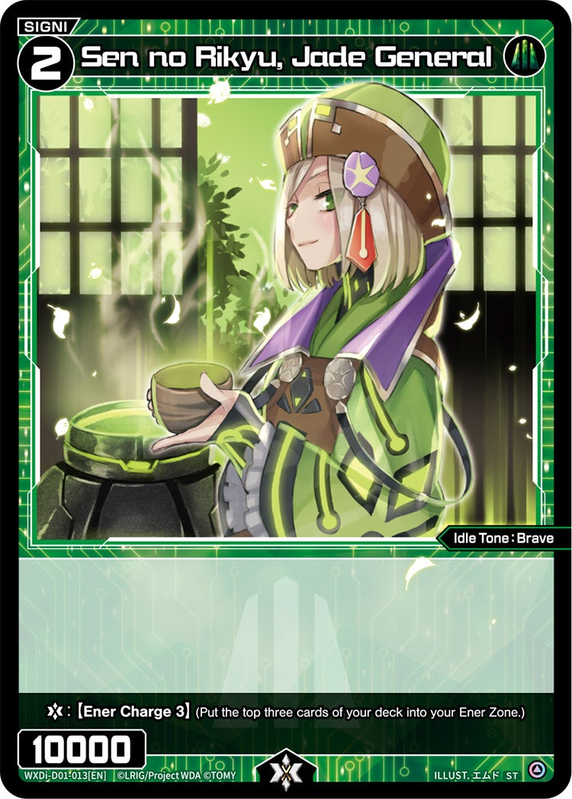

# Sen no Rikyu, Jade General

## Th?ng tin l?

| Tr??ng | Gi? tr? |
| --- | --- |
| M? in | WXDi-D01-013[EN] |
| Set | WXDi-D01[EN] |
| Lo?i th? | SIGNI |
| V? tr? | Main Deck |
| S? b?n D01 | 4 |
| M?u | Xanh l? |
| ?? hi?m | ST |
| Minh h?a | エムド |
| Level | 2 |
| Limit | ? |
| Power | 10000 |
| LRIG type / Class | Idol Tone：Brave |
| Team / Master | ? |
| Cost | ? |
| Grow cost | ? |
| Use timing | ? |
| Life Burst | C? |

## Card text ch?nh th?c

?

## Power text / Life Burst

【Ener Charge 3】 (Put the top three cards of your deck into your Ener Zone.)

## Ghi ch? minh h?a
Artist: エムド. ?nh ST ???c t?i t? Card List ti?ng Anh.

**Di?n gi?i Life Burst:** Ener Charge 3.

## FAQ ch?nh th?c

**Q. Correct process when this card's Life Burst activated with less than 2 cards left in my Main deck**
A. The following process:

(1).Put all the rest of cards of your Main deck into your Ener Zone.

(2).Refresh your Main deck. The process of Life Burst is already done, and can not more additional Ener Charge after Refresh.

## Ngu?n
[Card List/FAQ ch?nh th?c](https://www.takaratomy.co.jp/products/en.wixoss/card/card.html?card_no=WXDi-D01-013%5BEN%5D) ? [?nh th?](https://www.takaratomy.co.jp/products/en.wixoss/card/thumb/WXDi-D01-013%5BEN%5D.jpg)
