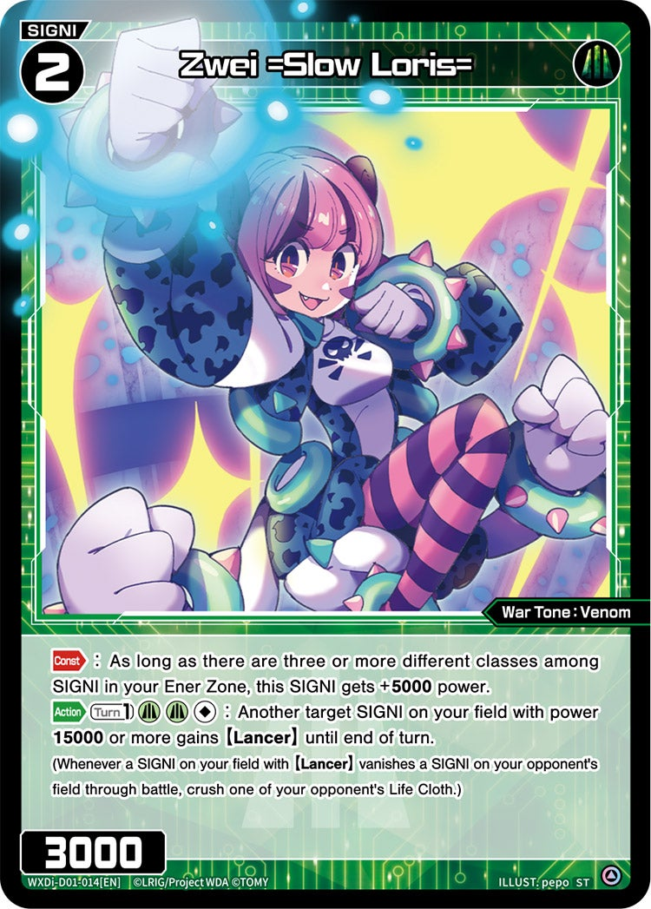

# Zwei =Slow Loris=

## Th?ng tin l?

| Tr??ng | Gi? tr? |
| --- | --- |
| M? in | WXDi-D01-014[EN] |
| Set | WXDi-D01[EN] |
| Lo?i th? | SIGNI |
| V? tr? | Main Deck |
| S? b?n D01 | 4 |
| M?u | Xanh l? |
| ?? hi?m | ST |
| Minh h?a | pepo |
| Level | 2 |
| Limit | ? |
| Power | 3000 |
| LRIG type / Class | War Tone：Venom |
| Team / Master | ? |
| Cost | ? |
| Grow cost | ? |
| Use timing | ? |
| Life Burst | Kh?ng |

## Card text ch?nh th?c

[Constant]: As long as there are three or more different classes among SIGNI in your Ener Zone, this SIGNI gets +5000 power.

[Action] {1/Turn} {Green} {Green} {Colorless}: Another target SIGNI on your field with power 15000 or more gains 【Lancer】 until end of turn.

(Whenever a SIGNI on your field with 【Lancer】 vanishes a SIGNI on your opponent's field through battle, crush one of your opponent's Life Cloth.)

## Power text / Life Burst

?

## Ghi ch? minh h?a
Artist: pepo. ?nh ST ???c t?i t? Card List ti?ng Anh.

## FAQ ch?nh th?c

**Q. I have a SIGNI with more than 15000 power gaining [Lancer] with Action ability. During the same turn, if the power of that SIGNI is reduced to lower than 15000, what happens to the [Lancer] of this SIGNI?**
A. Even if the power is lower than 15000, your SIGNI will still gain [Lancer] for the rest of the turn. Whether or not the power is over 15000 is only checked when you target it with [Action] ability, and it does not affect thereafter.

**Q. A SIGNI that gained [Lancer] from this card's ability was given [Double Crush] by another effect.**
A. A SIGNI that gained [Lancer] from this card's ability was given [Double Crush] by another effect. If this SIGNI vanishes opponent's SIGNI in battle, can I [Double Crush] my opponent's Life Cloth?

## Ngu?n
[Card List/FAQ ch?nh th?c](https://www.takaratomy.co.jp/products/en.wixoss/card/card.html?card_no=WXDi-D01-014%5BEN%5D) ? [?nh th?](https://www.takaratomy.co.jp/products/en.wixoss/card/thumb/WXDi-D01-014%5BEN%5D.jpg)
