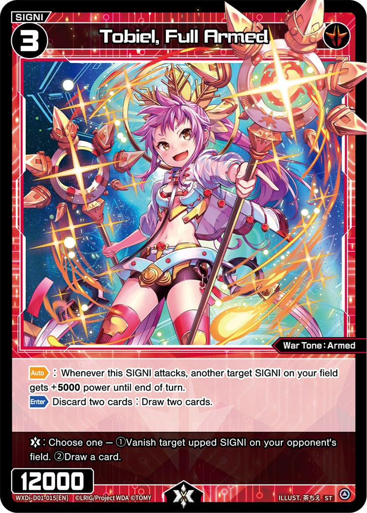

# Tobiel, Full Armed

## Thông tin lá

| Trường | Giá trị |
| --- | --- |
| Mã in | WXDi-D01-015[EN] |
| Set | WXDi-D01[EN] |
| Loại thẻ | SIGNI |
| Vị trí | Main Deck |
| Số bản D01 | 4 |
| Màu | Đỏ |
| Độ hiếm | ST |
| Minh họa | 茶ちえ |
| Level | 3 |
| Limit | — |
| Power | 12000 |
| LRIG type / Class | War Tone：Armed |
| Team / Master | — |
| Cost | — |
| Grow cost | — |
| Use timing | — |
| Life Burst | Có |

## Card text chính thức

[Auto]: Whenever this SIGNI attacks, another target SIGNI on your field gets +5000 power until end of turn.
[Enter] Discard two cards: Draw two cards.

## Power text / Life Burst

Choose one — ①Vanish target upped SIGNI on your opponent's field. ②Draw a card.

## Ghi chú minh họa
Artist: 茶ちえ. Ảnh ST được tải từ Card List tiếng Anh.

**Diễn giải Life Burst:** Chọn một: Vanish một SIGNI upped mục tiêu của đối thủ, hoặc rút một lá.

## FAQ chính thức

**Q. When I paid the cost of [Enter], I had only one card in my hand. Can I discard that one card and draw two cards?**
A. No, you can't. If you don't have enough cards in your hand to discard as cost, you can't discard any cards and you can't activate the effect.

## Nguồn
[Card List/FAQ chính thức](https://www.takaratomy.co.jp/products/en.wixoss/card/card.html?card_no=WXDi-D01-015%5BEN%5D ) · [Ảnh thẻ](https://www.takaratomy.co.jp/products/en.wixoss/card/thumb/WXDi-D01-015%5BEN%5D.jpg)
