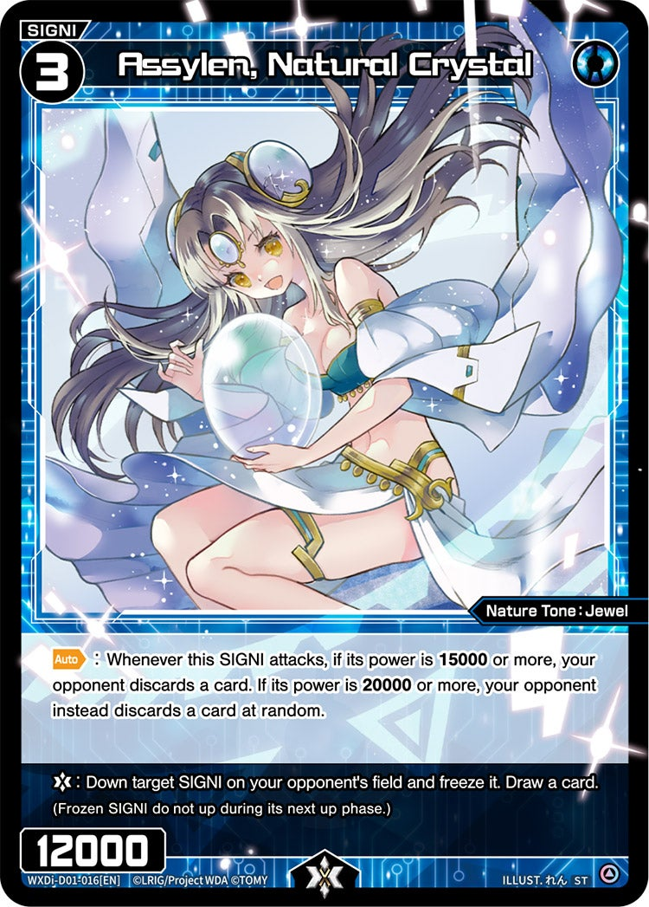

# Assylen, Natural Crystal

## Thông tin lá

| Trường | Giá trị |
| --- | --- |
| Mã in | WXDi-D01-016[EN] |
| Set | WXDi-D01[EN] |
| Loại thẻ | SIGNI |
| Vị trí | Main Deck |
| Số bản D01 | 4 |
| Màu | Xanh dương |
| Độ hiếm | ST |
| Minh họa | れん |
| Level | 3 |
| Limit | — |
| Power | 12000 |
| LRIG type / Class | Nature Tone：Jewel |
| Team / Master | — |
| Cost | — |
| Grow cost | — |
| Use timing | — |
| Life Burst | Có |

## Card text chính thức

[Auto]: Whenever this SIGNI attacks, if its power is 15000 or more, your opponent discards a card. If its power is 20000 or more, your opponent instead discards a card at random.

## Power text / Life Burst

Down target SIGNI on your opponent's field and freeze it. Draw a card.
(Frozen SIGNI do not up during its next up phase.)

## Ghi chú minh họa
Artist: れん. Ảnh ST được tải từ Card List tiếng Anh.

**Diễn giải Life Burst:** Down về Freeze một SIGNI mục tiêu của đối thủ, rồi rút một lá.

## FAQ chính thức

**Q. When I activate Life Burst, can I draw a card even if there is no SIGNI in opponent's field?**
A. Yes, you can. Even if there is no appropriate target, the latter effect will be processed.

## Nguồn
[Card List/FAQ chính thức](https://www.takaratomy.co.jp/products/en.wixoss/card/card.html?card_no=WXDi-D01-016%5BEN%5D ) · [Ảnh thẻ](https://www.takaratomy.co.jp/products/en.wixoss/card/thumb/WXDi-D01-016%5BEN%5D.jpg)
