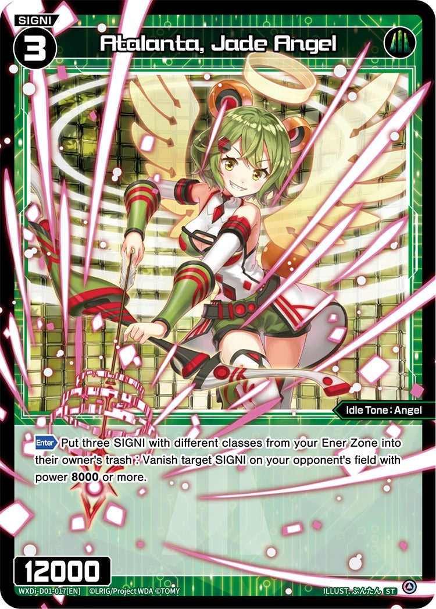

# Atalanta, Jade Angel

## Thông tin lá

| Trường | Giá trị |
| --- | --- |
| Mã in | WXDi-D01-017[EN] |
| Set | WXDi-D01[EN] |
| Loại thẻ | SIGNI |
| Vị trí | Main Deck |
| Số bản D01 | 4 |
| Màu | Xanh lá |
| Độ hiếm | ST |
| Minh họa | ぶんたん |
| Level | 3 |
| Limit | — |
| Power | 12000 |
| LRIG type / Class | Idol Tone：Angel |
| Team / Master | — |
| Cost | — |
| Grow cost | — |
| Use timing | — |
| Life Burst | Không |

## Card text chính thức

[Enter] Put three SIGNI with different classes from your Ener Zone into their owner's trash: Vanish target SIGNI on your opponent's field with power 8000 or more.

## Power text / Life Burst

—

## Ghi chú minh họa
Artist: ぶんたん. Ảnh ST được tải từ Card List tiếng Anh.

## FAQ chính thức

— (không có FAQ riêng cho mã này trên trang FAQ tiếng Anh.)

## Nguồn
[Card List/FAQ chính thức](https://www.takaratomy.co.jp/products/en.wixoss/card/card.html?card_no=WXDi-D01-017%5BEN%5D ) · [Ảnh thẻ](https://www.takaratomy.co.jp/products/en.wixoss/card/thumb/WXDi-D01-017%5BEN%5D.jpg)
