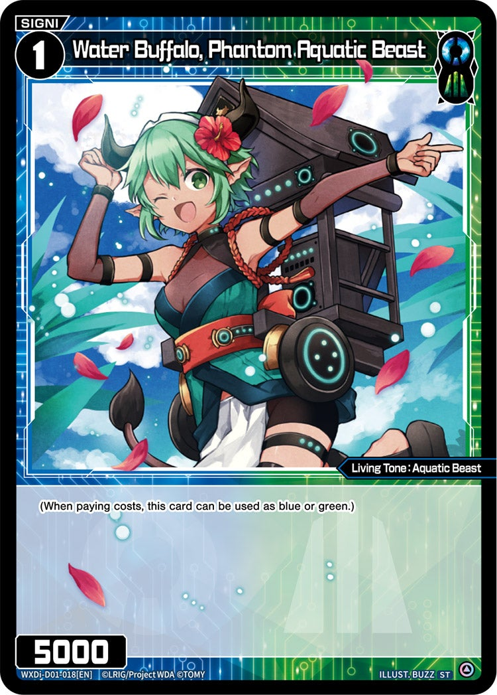

# Water Buffalo, Phantom Aquatic Beast

## Thông tin lá

| Trường | Giá trị |
| --- | --- |
| Mã in | WXDi-D01-018[EN] |
| Set | WXDi-D01[EN] |
| Loại thẻ | SIGNI |
| Vị trí | Main Deck |
| Số bản D01 | 4 |
| Màu | Xanh dương / xanh lá |
| Độ hiếm | ST |
| Minh họa | BUZZ |
| Level | 1 |
| Limit | — |
| Power | 5000 |
| LRIG type / Class | Living Tone：Aquatic Beast |
| Team / Master | — |
| Cost | — |
| Grow cost | — |
| Use timing | — |
| Life Burst | Không |

## Card text chính thức

(When paying costs, this card can be used as blue or green.)

## Power text / Life Burst

—

## Ghi chú minh họa
Artist: BUZZ. Ảnh ST được tải từ Card List tiếng Anh.

## Nguồn
[Card List/FAQ chính thức](https://www.takaratomy.co.jp/products/en.wixoss/card/card.html?card_no=WXDi-D01-018%5BEN%5D ) · [Ảnh thẻ](https://www.takaratomy.co.jp/products/en.wixoss/card/thumb/WXDi-D01-018%5BEN%5D.jpg)
