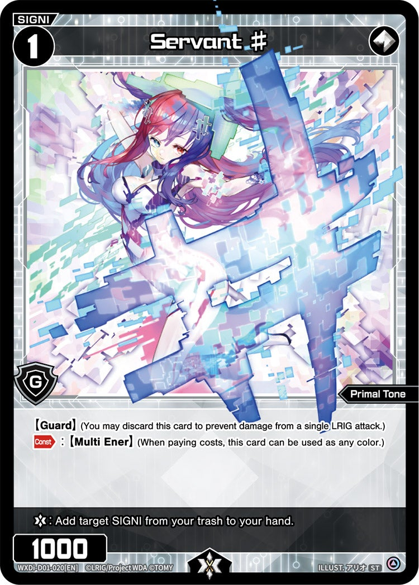

# Servant ♯

## Thông tin lá

| Trường | Giá trị |
| --- | --- |
| Mã in | WXDi-D01-020[EN] |
| Set | WXDi-D01[EN] |
| Loại thẻ | SIGNI |
| Vị trí | Main Deck |
| Số bản D01 | 4 |
| Màu | Không màu |
| Độ hiếm | ST |
| Minh họa | アリオ |
| Level | 1 |
| Limit | — |
| Power | 1000 |
| LRIG type / Class | Primal Tone |
| Team / Master | — |
| Cost | — |
| Grow cost | — |
| Use timing | Guard |
| Life Burst | Có |

## Card text chính thức

【Guard】 (You may discard this card to prevent damage from a single LRIG attack.)
[Constant]: 【Multi Ener】 (When paying costs, this card can be used as any color.)

## Power text / Life Burst

Add target SIGNI from your trash to your hand.

## Ghi chú minh họa
Artist: アリオ. Ảnh ST được tải từ Card List tiếng Anh.

**Diễn giải Life Burst:** Đưa một SIGNI mục tiêu trong Trash của mẢnh về hand.

## FAQ chính thức

**Q. Can I include more than 5 of these cards in my main deck?**
A. No, you can't have more than 5 cards with the same name in your deck.

## Nguồn
[Card List/FAQ chính thức](https://www.takaratomy.co.jp/products/en.wixoss/card/card.html?card_no=WXDi-D01-020%5BEN%5D ) · [Ảnh thẻ](https://www.takaratomy.co.jp/products/en.wixoss/card/thumb/WXDi-D01-020%5BEN%5D.jpg)
