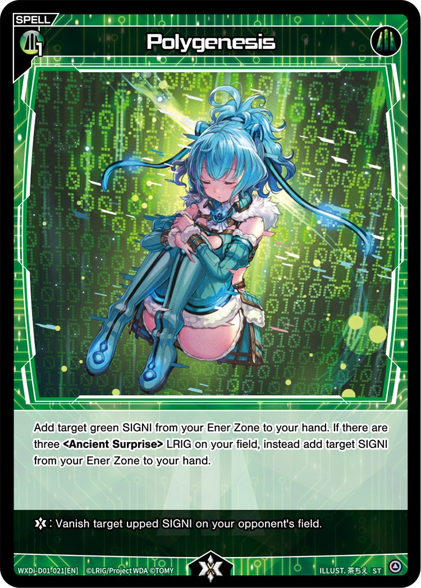

# Polygenesis

## Th?ng tin l?

| Tr??ng | Gi? tr? |
| --- | --- |
| M? in | WXDi-D01-021[EN] |
| Set | WXDi-D01[EN] |
| Lo?i th? | SPELL |
| V? tr? | Main Deck |
| S? b?n D01 | 4 |
| M?u | Xanh l? |
| ?? hi?m | ST |
| Minh h?a | 茶ちえ |
| Level | ? |
| Limit | ? |
| Power | 0 |
| LRIG type / Class | ? |
| Team / Master | ? |
| Cost | 《G》×１ |
| Grow cost | ? |
| Use timing | Main Phase |
| Life Burst | C? |

## Card text ch?nh th?c

Add target green SIGNI from your Ener Zone to your hand. If there are three <Ancient Surprise> LRIG on your field, instead add target SIGNI from your Ener Zone to your hand.

## Power text / Life Burst

Vanish target upped SIGNI on your opponent's field.

## Ghi ch? minh h?a
Artist: 茶ちえ. ?nh ST ???c t?i t? Card List ti?ng Anh.

**Di?n gi?i Life Burst:** Vanish m?t SIGNI upped m?c ti?u c?a ??i th?.

## FAQ ch?nh th?c

**Q. Can I add a card that was paid as Ener cost of this Spell and put into my trash to my hand as a target of this Spell's effect?**
A. No, you can't. You have to pay cost before you can select the target, so you can't select a card that is not in the Ener zone at that time.

## Ngu?n
[Card List/FAQ ch?nh th?c](https://www.takaratomy.co.jp/products/en.wixoss/card/card.html?card_no=WXDi-D01-021%5BEN%5D) ? [?nh th?](https://www.takaratomy.co.jp/products/en.wixoss/card/thumb/WXDi-D01-021%5BEN%5D.jpg)
