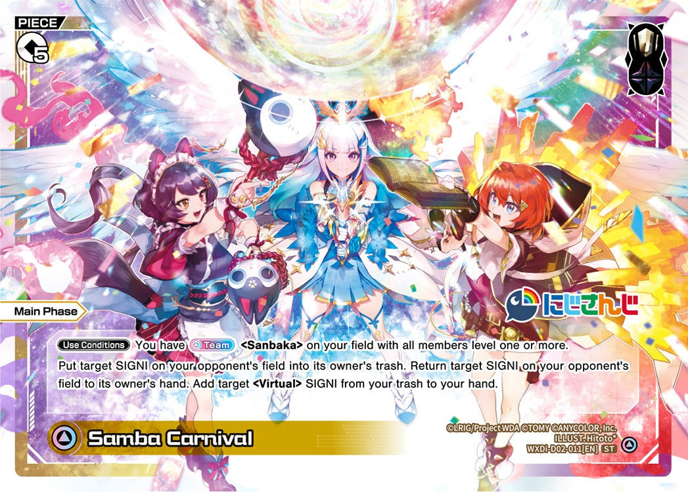

# Samba Carnival

## Thông tin lá

| Trường | Giá trị |
| --- | --- |
| Mã in | WXDi-D02-011[EN] |
| Set | WXDi-D02[EN] |
| Loại thẻ | PIECE |
| Vị trí | LRIG Deck |
| Số bản D02 | 1 |
| Màu | Trắng / đen |
| Độ hiếm | ST,DiR |
| Minh họa | Hitoto* |
| Level | — |
| Limit | — |
| Power | 0 |
| LRIG type / Class | — |
| Team / Master | — |
| Cost | 《C》×５ |
| Grow cost | — |
| Use timing | Main Phase |
| Life Burst | Không |

## Card text chính thức

[Use Conditions] You have [Team] <Sanbaka> on your field with all members level one or more.

Put target SIGNI on your opponent's field into its owner's trash. Return target SIGNI on your opponent's field to its owner's hand. Add target <Virtual> SIGNI from your trash to your hand.

## Power text / Life Burst

—

## Ghi chú minh họa
Artist: Hitoto*. Ảnh ST được tải từ Card List tiếng Anh.

## FAQ chính thức

**Q. If you use this card when there is only one SIGNI in your opponent's field.**
A. In that case, the two effects targeting the opponent's SIGNI will both choose that SIGNI. The effects are processed in order from the top of the text, so the SIGNI will be put into Trash (not back into your hand).

## Ảnh biến thể

- [DiR](../images/WXDi-D02-011D-EN.jpg)

## Nguồn
[Card List/FAQ chính thức](https://www.takaratomy.co.jp/products/en.wixoss/card/card.html?card_no=WXDi-D02-011%5BEN%5D ) · [Ảnh thẻ](https://www.takaratomy.co.jp/products/en.wixoss/card/thumb/WXDi-D02-011%5BEN%5D.jpg)
