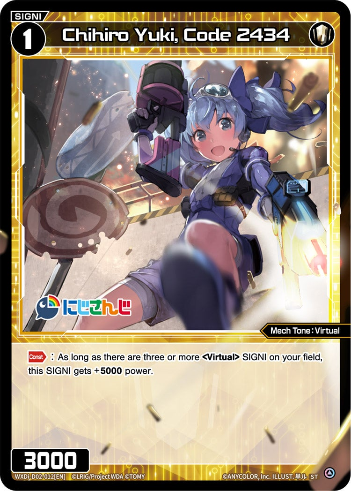

# Chihiro Yuki, Code 2434

## Thông tin lá

| Trường | Giá trị |
| --- | --- |
| Mã in | WXDi-D02-012[EN] |
| Set | WXDi-D02[EN] |
| Loại thẻ | SIGNI |
| Vị trí | Main Deck |
| Số bản D02 | 4 |
| Màu | Trắng |
| Độ hiếm | ST,ST(P) |
| Minh họa | 単ル |
| Level | 1 |
| Limit | — |
| Power | 3000 |
| LRIG type / Class | Mech Tone：Virtual |
| Team / Master | — |
| Cost | — |
| Grow cost | — |
| Use timing | — |
| Life Burst | Không |

## Card text chính thức

[Constant]: As long as there are three or more <Virtual> SIGNI on your field, this SIGNI gets +5000 power.

## Power text / Life Burst

—

## Ghi chú minh họa
Artist: 単ル. Ảnh ST được tải từ Card List tiếng Anh.

## FAQ chính thức

— (không có FAQ riêng cho mã này trên trang FAQ tiếng Anh.)

## Ảnh biến thể

- [ST(P)](../images/WXDi-D02-012P-EN.jpg)

## Nguồn
[Card List/FAQ chính thức](https://www.takaratomy.co.jp/products/en.wixoss/card/card.html?card_no=WXDi-D02-012%5BEN%5D ) · [Ảnh thẻ](https://www.takaratomy.co.jp/products/en.wixoss/card/thumb/WXDi-D02-012%5BEN%5D.jpg)
