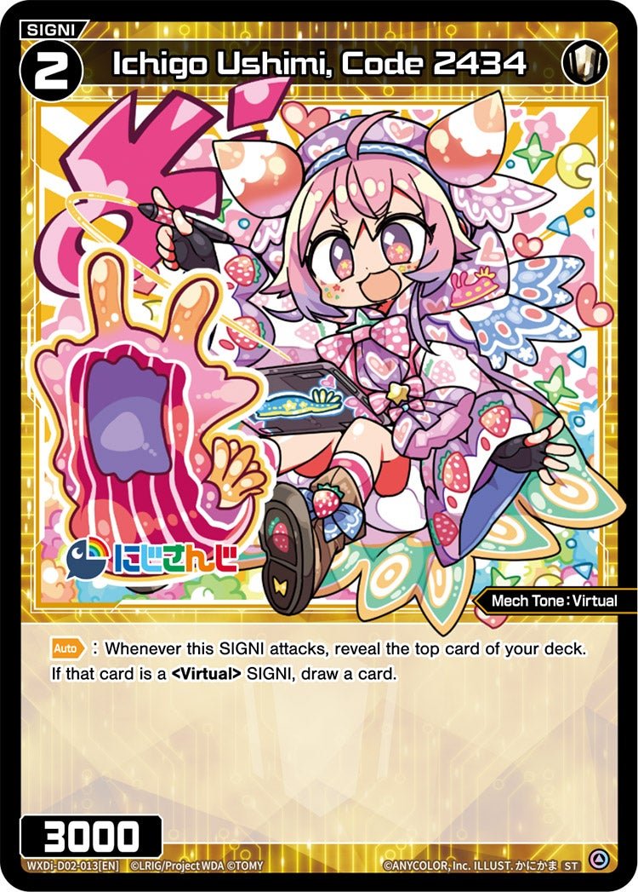

# Ichigo Ushimi, Code 2434

## Thông tin lá

| Trường | Giá trị |
| --- | --- |
| Mã in | WXDi-D02-013[EN] |
| Set | WXDi-D02[EN] |
| Loại thẻ | SIGNI |
| Vị trí | Main Deck |
| Số bản D02 | 4 |
| Màu | Trắng |
| Độ hiếm | ST,ST(P) |
| Minh họa | かにかま |
| Level | 2 |
| Limit | — |
| Power | 3000 |
| LRIG type / Class | Mech Tone：Virtual |
| Team / Master | — |
| Cost | — |
| Grow cost | — |
| Use timing | — |
| Life Burst | Không |

## Card text chính thức

[Auto]: Whenever this SIGNI attacks, reveal the top card of your deck. If that card is a <Virtual> SIGNI, draw a card.

## Power text / Life Burst

—

## Ghi chú minh họa
Artist: かにかま. Ảnh ST được tải từ Card List tiếng Anh.

## FAQ chính thức

**Q. If the revealed card is <Virtual>SIGNI, will the revealed card be added to my hand by this effect?**
A. Yes, the revealed card is still on the top of the deck, so the effect to draw a card will draw that card.

**Q. If the revealed card is not a card that meets the requirements.**
A. In that case, the revealed card is turned back face down and the effect ends.

## Ảnh biến thể

- [ST(P)](../images/WXDi-D02-013P-EN.jpg)

## Nguồn
[Card List/FAQ chính thức](https://www.takaratomy.co.jp/products/en.wixoss/card/card.html?card_no=WXDi-D02-013%5BEN%5D ) · [Ảnh thẻ](https://www.takaratomy.co.jp/products/en.wixoss/card/thumb/WXDi-D02-013%5BEN%5D.jpg)
