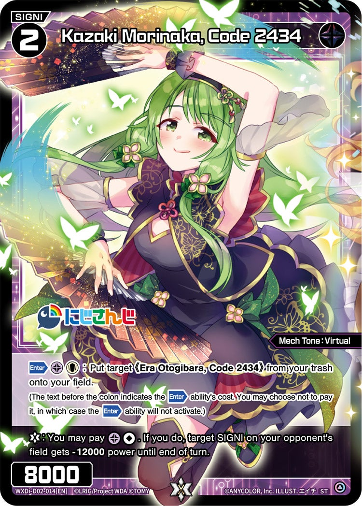

# Kazaki Morinaka, Code 2434

## Thông tin lá

| Trường | Giá trị |
| --- | --- |
| Mã in | WXDi-D02-014[EN] |
| Set | WXDi-D02[EN] |
| Loại thẻ | SIGNI |
| Vị trí | Main Deck |
| Số bản D02 | 4 |
| Màu | Đen |
| Độ hiếm | ST,ST(P) |
| Minh họa | エイチ |
| Level | 2 |
| Limit | — |
| Power | 8000 |
| LRIG type / Class | Mech Tone：Virtual |
| Team / Master | — |
| Cost | — |
| Grow cost | — |
| Use timing | — |
| Life Burst | Có |

## Card text chính thức

[Enter] {Black} {White}: Put target 《Era Otogibara, Code 2434》 from your trash onto your field.
(The text before the colon indicates the [Enter] ability's cost. You may choose not to pay it, in which case the [Enter] ability will not activate.)

## Power text / Life Burst

You may pay {Black} {Colorless}. If you do, target SIGNI on your opponent's field gets -12000 power until end of turn.

## Ghi chú minh họa
Artist: エイチ. Ảnh ST được tải từ Card List tiếng Anh.

## FAQ chính thức

**Q. I paid {White} for the cost of [Enter], 《Code 2434: Erara Otogihara》. Can I target that 《Code2434EraOgaihara》 by the effect?**
A. Yes, you can. When you activate [Enter], you pay cost and then choose a target, so you can target 《Era Otogihara Code 2434》 in Trash at that time.

## Ảnh biến thể

- [ST(P)](../images/WXDi-D02-014P-EN.jpg)

## Nguồn
[Card List/FAQ chính thức](https://www.takaratomy.co.jp/products/en.wixoss/card/card.html?card_no=WXDi-D02-014%5BEN%5D ) · [Ảnh thẻ](https://www.takaratomy.co.jp/products/en.wixoss/card/thumb/WXDi-D02-014%5BEN%5D.jpg)
