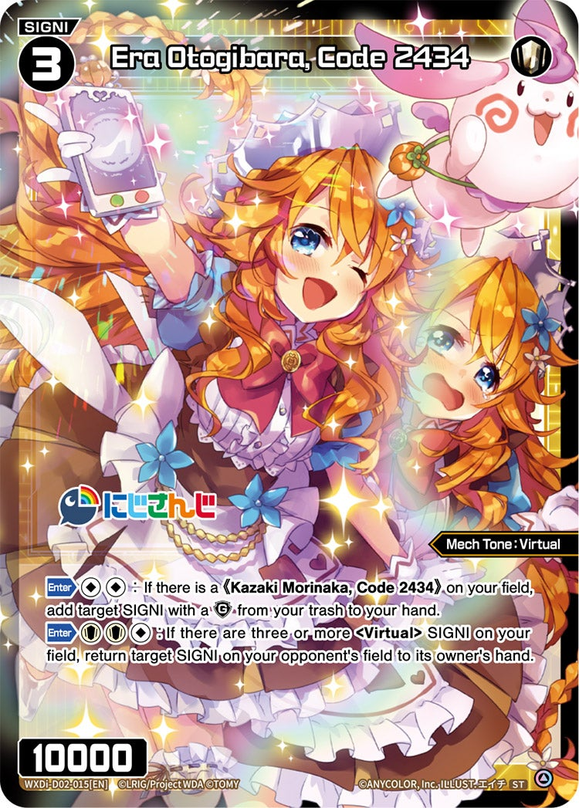

# Era Otogibara, Code 2434

## Thông tin lá

| Trường | Giá trị |
| --- | --- |
| Mã in | WXDi-D02-015[EN] |
| Set | WXDi-D02[EN] |
| Loại thẻ | SIGNI |
| Vị trí | Main Deck |
| Số bản D02 | 4 |
| Màu | Trắng |
| Độ hiếm | ST,ST(P) |
| Minh họa | エイチ |
| Level | 3 |
| Limit | — |
| Power | 10000 |
| LRIG type / Class | Mech Tone：Virtual |
| Team / Master | — |
| Cost | — |
| Grow cost | — |
| Use timing | — |
| Life Burst | Không |

## Card text chính thức

[Enter] {Colorless} {Colorless}: If there is a 《Kazaki Morinaka, Code 2434》 on your field, add target SIGNI with a {Guard Icon} from your trash to your hand.
[Enter] {White} {White} {Colorless}: If there are three or more <Virtual> SIGNI on your field, return target SIGNI on your opponent's field to its owner's hand.

## Power text / Life Burst

—

## Ghi chú minh họa
Artist: エイチ. Ảnh ST được tải từ Card List tiếng Anh.

## FAQ chính thức

**Q. I paid for a SIGNI with {Guard Icon} as cost for [Enter] in the first text. Can I target that SIGNI with {Guard Icon} as an effect?**
A. Yes, you can. When you activate [Enter], you pay cost and then choose a target, so you can target a SIGNI with {Guard Icon} in Trash at that time.

## Ảnh biến thể

- [ST(P)](../images/WXDi-D02-015P-EN.jpg)

## Nguồn
[Card List/FAQ chính thức](https://www.takaratomy.co.jp/products/en.wixoss/card/card.html?card_no=WXDi-D02-015%5BEN%5D ) · [Ảnh thẻ](https://www.takaratomy.co.jp/products/en.wixoss/card/thumb/WXDi-D02-015%5BEN%5D.jpg)
