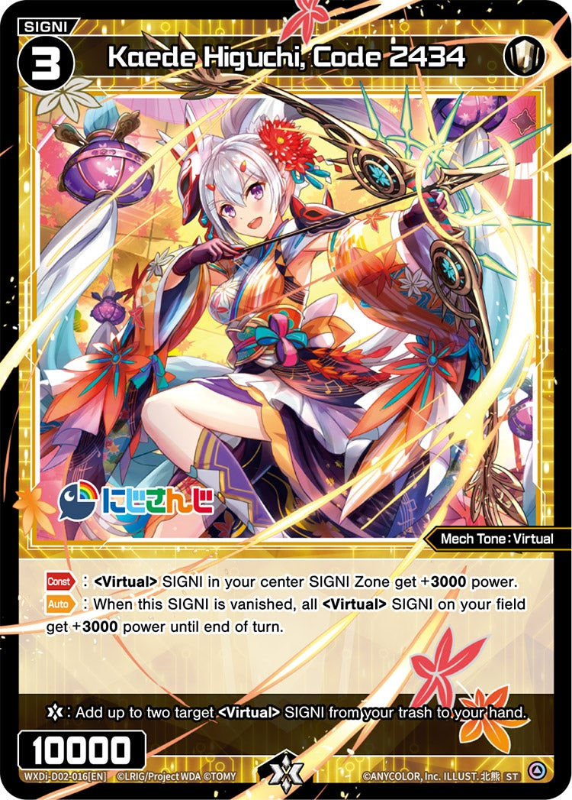

# Kaede Higuchi, Code 2434

## Thông tin lá

| Trường | Giá trị |
| --- | --- |
| Mã in | WXDi-D02-016[EN] |
| Set | WXDi-D02[EN] |
| Loại thẻ | SIGNI |
| Vị trí | Main Deck |
| Số bản D02 | 4 |
| Màu | Trắng |
| Độ hiếm | ST,ST(P) |
| Minh họa | 北熊 |
| Level | 3 |
| Limit | — |
| Power | 10000 |
| LRIG type / Class | Mech Tone：Virtual |
| Team / Master | — |
| Cost | — |
| Grow cost | — |
| Use timing | — |
| Life Burst | Có |

## Card text chính thức

[Constant]: <Virtual> SIGNI in your center SIGNI Zone get +3000 power.
[Auto]: When this SIGNI is vanished, all <Virtual> SIGNI on your field get +3000 power until end of turn.

## Power text / Life Burst

Add up to two target <Virtual> SIGNI from your trash to your hand.

## Ghi chú minh họa
Artist: 北熊. Ảnh ST được tải từ Card List tiếng Anh.

## FAQ chính thức

**Q. If this SIGNI itself is placed in the center SIGNI zone, does it gain +3000 power from [Constant]?**
A. Yes, it does.

**Q. If I put a <Virtual> SIGNI on the field during the same turn after [Auto] is activated, does it get +3000?**
A. No, it does not. [Auto] only affects the <Virtual> SIGNI in your field at the time it is activated, not the power of later SIGNI.

## Ảnh biến thể

- [ST(P)](../images/WXDi-D02-016P-EN.jpg)

## Nguồn
[Card List/FAQ chính thức](https://www.takaratomy.co.jp/products/en.wixoss/card/card.html?card_no=WXDi-D02-016%5BEN%5D ) · [Ảnh thẻ](https://www.takaratomy.co.jp/products/en.wixoss/card/thumb/WXDi-D02-016%5BEN%5D.jpg)
