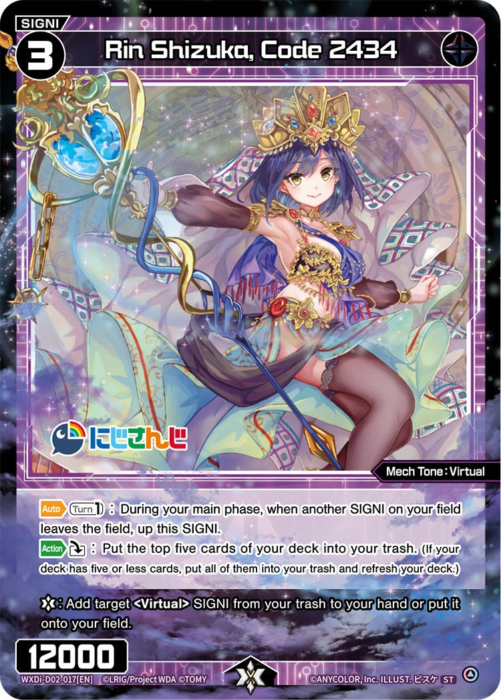

# Rin Shizuka, Code 2434

## Thông tin lá

| Trường | Giá trị |
| --- | --- |
| Mã in | WXDi-D02-017[EN] |
| Set | WXDi-D02[EN] |
| Loại thẻ | SIGNI |
| Vị trí | Main Deck |
| Số bản D02 | 4 |
| Màu | Đen |
| Độ hiếm | ST,ST(P) |
| Minh họa | ピスケ |
| Level | 3 |
| Limit | — |
| Power | 12000 |
| LRIG type / Class | Mech Tone：Virtual |
| Team / Master | — |
| Cost | — |
| Grow cost | — |
| Use timing | — |
| Life Burst | Có |

## Card text chính thức

[Auto] {1/Turn}: During your main phase, when another SIGNI on your field leaves the field, up this SIGNI.
[Action] {Down}: Put the top five cards of your deck into your trash. (If your deck has five or less cards, put all of them into your trash and refresh your deck.)

## Power text / Life Burst

Add target <Virtual> SIGNI from your trash to your hand or put it onto your field.

## Ghi chú minh họa
Artist: ピスケ. Ảnh ST được tải từ Card List tiếng Anh.

## FAQ chính thức

**Q. Is this [Auto] triggered even if this SIGNI is upped?**
A. Yes, even if this SIGNI is upped, it will activate if it meets the conditions. However, this is a turn-limited ability, so if this ability is activated while it is in the Upped and then it becomes Downed, it cannot be activated again during that turn.

## Ảnh biến thể

- [ST(P)](../images/WXDi-D02-017P-EN.jpg)

## Nguồn
[Card List/FAQ chính thức](https://www.takaratomy.co.jp/products/en.wixoss/card/card.html?card_no=WXDi-D02-017%5BEN%5D ) · [Ảnh thẻ](https://www.takaratomy.co.jp/products/en.wixoss/card/thumb/WXDi-D02-017%5BEN%5D.jpg)
