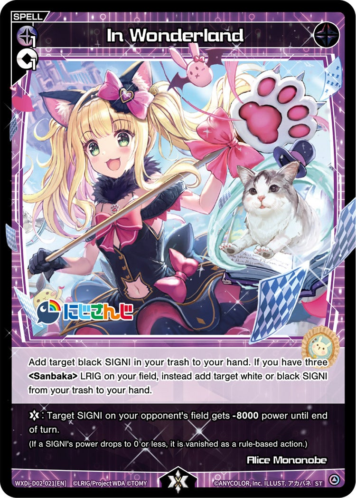

# In Wonderland

## Thông tin lá

| Trường | Giá trị |
| --- | --- |
| Mã in | WXDi-D02-021[EN] |
| Set | WXDi-D02[EN] |
| Loại thẻ | SPELL |
| Vị trí | Main Deck |
| Số bản D02 | 4 |
| Màu | Đen |
| Độ hiếm | ST,ST(P) |
| Minh họa | アカバネ |
| Level | — |
| Limit | — |
| Power | 0 |
| LRIG type / Class | — |
| Team / Master | — |
| Cost | 《B》×１ / 《C》×１ |
| Grow cost | — |
| Use timing | — |
| Life Burst | Có |

## Card text chính thức

Add target black SIGNI in your trash to your hand. If you have three <Sanbaka> LRIG on your field, instead add target white or black SIGNI from your trash to your hand.

## Power text / Life Burst

Target SIGNI on your opponent's field gets -8000 power until end of turn.
(If a SIGNI's power drops to 0 or less, it is vanished as a rule-based action.)

## Ghi chú minh họa
Artist: アカバネ. Ảnh ST được tải từ Card List tiếng Anh.

## FAQ chính thức

**Q. Can I add SIGNI paid as Enercost for this Spell to my hand as a target?**
A. Yes, you can, since you choose the target after paying cost, and you can target cards that are in Trash at that time.

## Ảnh biến thể

- [ST(P)](../images/WXDi-D02-021P-EN.jpg)

## Nguồn
[Card List/FAQ chính thức](https://www.takaratomy.co.jp/products/en.wixoss/card/card.html?card_no=WXDi-D02-021%5BEN%5D ) · [Ảnh thẻ](https://www.takaratomy.co.jp/products/en.wixoss/card/thumb/WXDi-D02-021%5BEN%5D.jpg)
