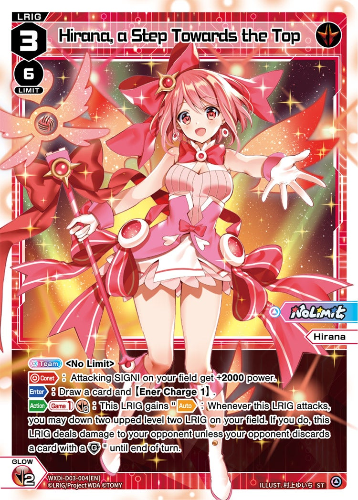

# Hirana, a Step Towards the Top

## Thông tin lá

| Trường | Giá trị |
| --- | --- |
| Mã in | WXDi-D03-004[EN] |
| Set | WXDi-D03[EN] |
| Loại thẻ | LRIG |
| Vị trí | LRIG Deck |
| Số bản D03 | 1 |
| Màu | Đỏ |
| Độ hiếm | ST,SCR,DiR |
| Minh họa | 村上ゆいち |
| Level | 3 |
| Limit | 6 |
| Power | 0 |
| LRIG type / Class | Hirana |
| Team / Master | No Limit |
| Cost | — |
| Grow cost | 《R》×２ |
| Use timing | — |
| Life Burst | Không |

## Card text chính thức

[Team] <No Limit>
[Team Constant]: Attacking SIGNI on your field get +2000 power.
[Enter]: Draw a card and 【Ener Charge 1】.
[Action] {1/Game} {Redx0}: This LRIG gains "[Auto]: Whenever this LRIG attacks, you may down two upped level two LRIG on your field. If you do, this LRIG deals damage to your opponent unless your opponent discards a card with a {Guard Icon}" until end of turn.

## Power text / Life Burst

—

## Ghi chú minh họa
Artist: 村上ゆいち. Ảnh ST được tải từ Card List tiếng Anh.

## FAQ chính thức

**Q. What does it mean by [Team]?**
A. It means the team indicated by that card. The [Team Auto], [Team Action], [Team Constant], and [Team Enter] abilities of the card are valid only if all 3 LRIGs in your field are the indicated [Team].
In the case of this card, if all three of your LRIGs are <No Limit>, you will be able to use the [Team Constant] ability.

**Q. What does it mean [Auto]: Whenever this LRIG attacks, you may down two upped level two LRIG on your field. If you do, this LRIG deals damage to your opponent unless your opponent discards a card with a {Guard Icon}?**
A. This ability allows the LRIG Attack, which normally can only deal damage once per turn, to be dealt twice per turn just once.

When you actually use the ability, the process is as follows
1. Declare an LRIG Attack and DOWN the Center LRIG.
2. This [Auto] will trigger. By DOWN the other two LRIGs, the following If you do effect will be triggered.
3.The effect of [Auto] will deal damage to your opponent. This damage can be prevented by discarding a card with the [Guard] icon. Then, the process of [Auto] is end.
4. Perform the process of normal LRIG Attack. Your opponent can [Guard].

**Q. I used 《Glory Grow》（D03-011[EN]） and gave [Double Crush] to this LRIG. Can [Auto]'s damage [Double Crush] the life cloths?**
A. No, you can't. [Double Crush] is valid only when a SIGNI or LRIG’s normal attack and deals damage to a player. And it does not apply to damage from effects. As a result, only one Life Cloth is crushed by [Auto]'s effect.

## Ảnh biến thể

- [SCR](../images/WXDi-D03-004S-EN.jpg)
- [DiR](../images/WXDi-D03-004D-EN.jpg)

## Nguồn
[Card List/FAQ chính thức](https://www.takaratomy.co.jp/products/en.wixoss/card/card.html?card_no=WXDi-D03-004%5BEN%5D ) · [Ảnh thẻ](https://www.takaratomy.co.jp/products/en.wixoss/card/thumb/WXDi-D03-004%5BEN%5D.jpg)
