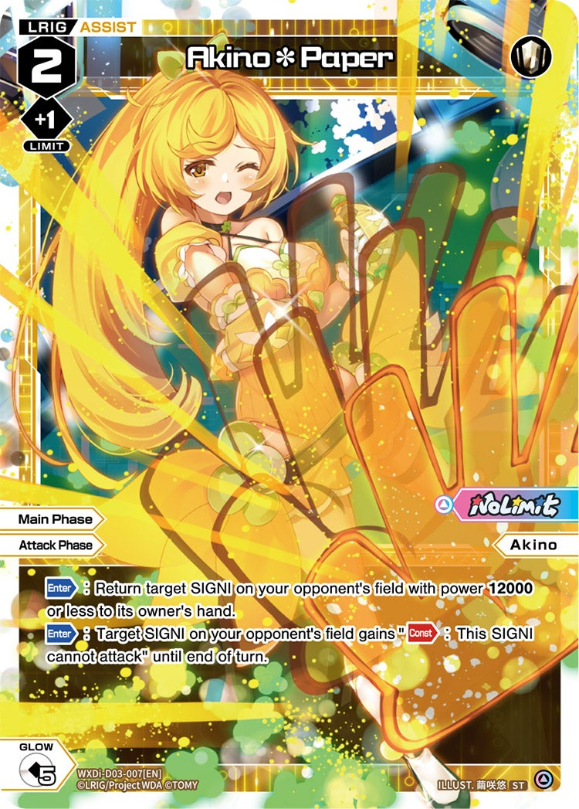

# Akino*Paper

## Thông tin lá

| Trường | Giá trị |
| --- | --- |
| Mã in | WXDi-D03-007[EN] |
| Set | WXDi-D03[EN] |
| Loại thẻ | ASSIST LRIG |
| Vị trí | LRIG Deck |
| Số bản D03 | 1 |
| Màu | Trắng |
| Độ hiếm | ST |
| Minh họa | 繭咲悠 |
| Level | 2 |
| Limit | ＋１ |
| Power | 0 |
| LRIG type / Class | Akino |
| Team / Master | No Limit |
| Cost | — |
| Grow cost | 《C》×５ |
| Use timing | Main Phase
Attack Phase |
| Life Burst | Không |

## Card text chính thức

[Enter]: Return target SIGNI on your opponent's field with power 12000 or less to its owner's hand.
[Enter]: Target SIGNI on your opponent's field gains "[Constant]: This SIGNI cannot attack" until end of turn.

## Power text / Life Burst

—

## Ghi chú minh họa
Artist: 繭咲悠. Ảnh ST được tải từ Card List tiếng Anh.

## FAQ chính thức

**Q. Is it possible to not use the [Enter] ability?**
A. No, [Enter] ability with no cost (described before:) is compulsory. Even if you don't want to use the effect, if there is a target that fits the condition, you must use the effect on it.

## Nguồn
[Card List/FAQ chính thức](https://www.takaratomy.co.jp/products/en.wixoss/card/card.html?card_no=WXDi-D03-007%5BEN%5D ) · [Ảnh thẻ](https://www.takaratomy.co.jp/products/en.wixoss/card/thumb/WXDi-D03-007%5BEN%5D.jpg)
