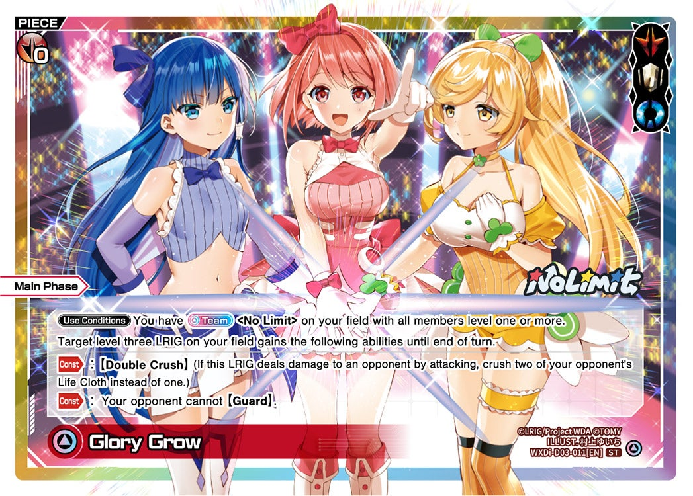

# Glory Grow

## Thông tin lá

| Trường | Giá trị |
| --- | --- |
| Mã in | WXDi-D03-011[EN] |
| Set | WXDi-D03[EN] |
| Loại thẻ | PIECE |
| Vị trí | LRIG Deck |
| Số bản D03 | 1 |
| Màu | Đỏ / trắng / xanh dương |
| Độ hiếm | ST,DiR |
| Minh họa | 村上ゆいち |
| Level | — |
| Limit | — |
| Power | 0 |
| LRIG type / Class | — |
| Team / Master | — |
| Cost | 《R》×０ |
| Grow cost | — |
| Use timing | Main Phase |
| Life Burst | Không |

## Card text chính thức

[Use Conditions] You have [Team] <No Limit> on your field with all members level one or more.

Target level three LRIG on your field gains the following abilities until end of turn.
『[Constant]: 【Double Crush】 (If this LRIG deals damage to an opponent by attacking, crush two of your opponent's Life Cloth instead of one.)
[Constant]: Your opponent cannot 【Guard】.』

## Power text / Life Burst

—

## Ghi chú minh họa
Artist: 村上ゆいち. Ảnh ST được tải từ Card List tiếng Anh.

## FAQ chính thức

— (không có FAQ riêng cho mã này trên trang FAQ tiếng Anh.)

## Ảnh biến thể

- [DiR](../images/WXDi-D03-011D-EN.jpg)

## Nguồn
[Card List/FAQ chính thức](https://www.takaratomy.co.jp/products/en.wixoss/card/card.html?card_no=WXDi-D03-011%5BEN%5D ) · [Ảnh thẻ](https://www.takaratomy.co.jp/products/en.wixoss/card/thumb/WXDi-D03-011%5BEN%5D.jpg)
