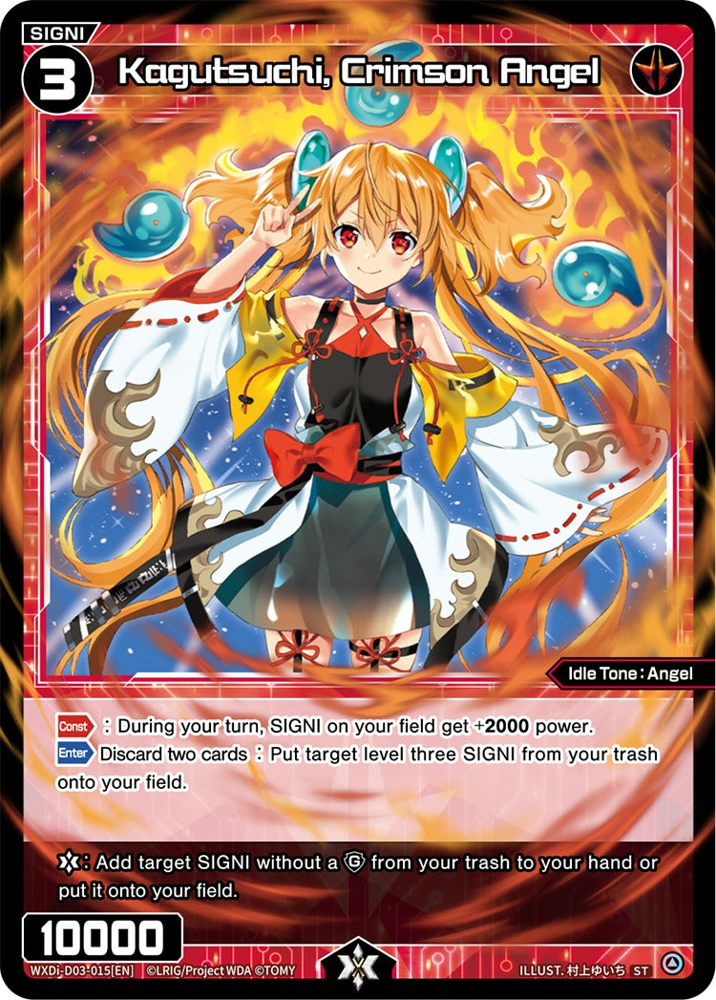

# Kagutsuchi, Crimson Angel

## Thông tin lá

| Trường | Giá trị |
| --- | --- |
| Mã in | WXDi-D03-015[EN] |
| Set | WXDi-D03[EN] |
| Loại thẻ | SIGNI |
| Vị trí | Main Deck |
| Số bản D03 | 4 |
| Màu | Đỏ |
| Độ hiếm | ST |
| Minh họa | 村上ゆいち |
| Level | 3 |
| Limit | — |
| Power | 10000 |
| LRIG type / Class | Idol Tone：Angel |
| Team / Master | — |
| Cost | — |
| Grow cost | — |
| Use timing | — |
| Life Burst | Có |

## Card text chính thức

[Constant]: During your turn, SIGNI on your field get +2000 power.
[Enter] Discard two cards: Put target level three SIGNI from your trash onto your field.

## Power text / Life Burst

Add target SIGNI without a {Guard Icon} from your trash to your hand or put it onto your field.

## Ghi chú minh họa
Artist: 村上ゆいち. Ảnh ST được tải từ Card List tiếng Anh.

## FAQ chính thức

**Q. Can I put a card discarded as a cost of [Enter] into the field by its effect?**
A. Yes, you can. You pay the cost and then target it, so if it is a SIGNI that meets the condition, you can target it and put it on the field.

## Nguồn
[Card List/FAQ chính thức](https://www.takaratomy.co.jp/products/en.wixoss/card/card.html?card_no=WXDi-D03-015%5BEN%5D ) · [Ảnh thẻ](https://www.takaratomy.co.jp/products/en.wixoss/card/thumb/WXDi-D03-015%5BEN%5D.jpg)
