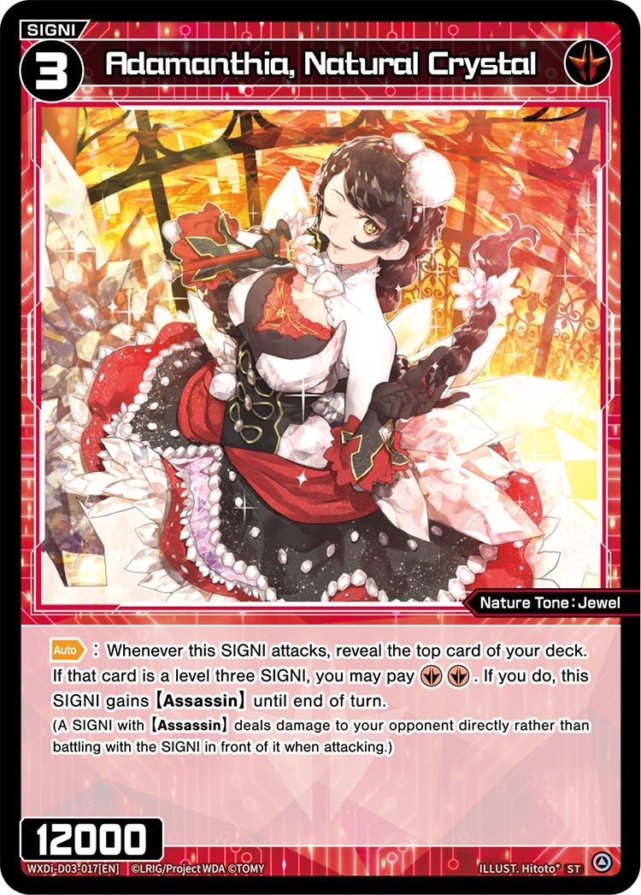

# Adamanthia, Natural Crystal

## Thông tin lá

| Trường | Giá trị |
| --- | --- |
| Mã in | WXDi-D03-017[EN] |
| Set | WXDi-D03[EN] |
| Loại thẻ | SIGNI |
| Vị trí | Main Deck |
| Số bản D03 | 4 |
| Màu | Đỏ |
| Độ hiếm | ST |
| Minh họa | Hitoto* |
| Level | 3 |
| Limit | — |
| Power | 12000 |
| LRIG type / Class | Nature Tone：Jewel |
| Team / Master | — |
| Cost | — |
| Grow cost | — |
| Use timing | — |
| Life Burst | Không |

## Card text chính thức

[Auto]: Whenever this SIGNI attacks, reveal the top card of your deck. If that card is a level three SIGNI, you may pay {Red} {Red}. If you do, this SIGNI gains 【Assassin】 until end of turn.
(A SIGNI with 【Assassin】 deals damage to your opponent directly rather than battling with the SIGNI in front of it when attacking.)

## Power text / Life Burst

—

## Ghi chú minh họa
Artist: Hitoto*. Ảnh ST được tải từ Card List tiếng Anh.

## FAQ chính thức

**Q. Does the revealed card remain revealed afterwards?**
A. No, after checking the card, whether it meets the condition or not, it will be turned back face down after processing this [Auto] ability.

## Nguồn
[Card List/FAQ chính thức](https://www.takaratomy.co.jp/products/en.wixoss/card/card.html?card_no=WXDi-D03-017%5BEN%5D ) · [Ảnh thẻ](https://www.takaratomy.co.jp/products/en.wixoss/card/thumb/WXDi-D03-017%5BEN%5D.jpg)
