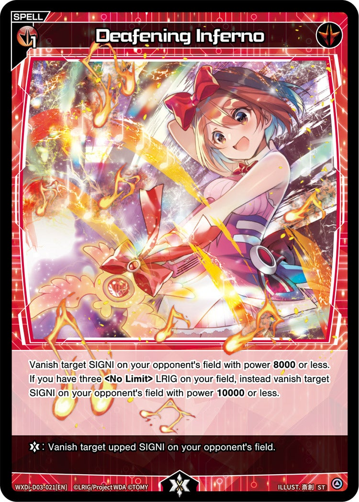

# Deafening Inferno

## Thông tin lá

| Trường | Giá trị |
| --- | --- |
| Mã in | WXDi-D03-021[EN] |
| Set | WXDi-D03[EN] |
| Loại thẻ | SPELL |
| Vị trí | Main Deck |
| Số bản D03 | 4 |
| Màu | Đỏ |
| Độ hiếm | ST |
| Minh họa | 斎創 |
| Level | — |
| Limit | — |
| Power | 0 |
| LRIG type / Class | — |
| Team / Master | — |
| Cost | 《R》×１ |
| Grow cost | — |
| Use timing | — |
| Life Burst | Có |

## Card text chính thức

Vanish target SIGNI on your opponent's field with power 8000 or less. If you have three <No Limit> LRIG on your field, instead vanish target SIGNI on your opponent's field with power 10000 or less.

## Power text / Life Burst

Vanish target upped SIGNI on your opponent's field.

## Ghi chú minh họa
Artist: 斎創. Ảnh ST được tải từ Card List tiếng Anh.

## FAQ chính thức

— (không có FAQ riêng cho mã này trên trang FAQ tiếng Anh.)

## Nguồn
[Card List/FAQ chính thức](https://www.takaratomy.co.jp/products/en.wixoss/card/card.html?card_no=WXDi-D03-021%5BEN%5D ) · [Ảnh thẻ](https://www.takaratomy.co.jp/products/en.wixoss/card/thumb/WXDi-D03-021%5BEN%5D.jpg)
