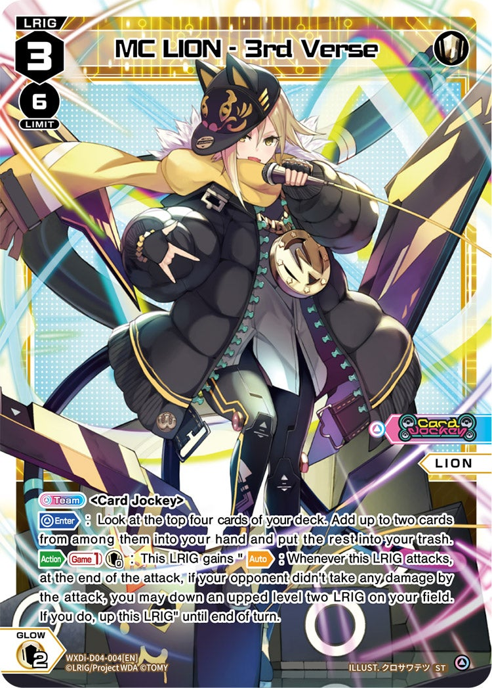

# MC LION - 3rd Verse

## Thông tin lá

| Trường | Giá trị |
| --- | --- |
| Mã in | WXDi-D04-004[EN] |
| Set | WXDi-D04[EN] |
| Loại thẻ | LRIG |
| Vị trí | LRIG Deck |
| Số bản D04 | 1 |
| Màu | Trắng |
| Độ hiếm | ST,SCR,DiR |
| Minh họa | クロサワテツ |
| Level | 3 |
| Limit | 6 |
| Power | 0 |
| LRIG type / Class | LION |
| Team / Master | Card Jockey |
| Cost | — |
| Grow cost | 《W》×２ |
| Use timing | — |
| Life Burst | Không |

## Card text chính thức

[Team] <Card Jockey>
[Team Enter]: Look at the top four cards of your deck. Add up to two cards from among them into your hand and put the rest into your trash.
[Action] {1/Game} {Whitex0}: This LRIG gains "[Auto]: Whenever this LRIG attacks, at the end of the attack, if your opponent didn't take any damage by the attack, you may down an upped level two LRIG on your field. If you do, up this LRIG" until end of turn.

## Power text / Life Burst

—

## Ghi chú minh họa
Artist: クロサワテツ. Ảnh ST được tải từ Card List tiếng Anh.

## FAQ chính thức

**Q. What does it mean by [Team]?**
A. It means the team indicated by that card. The [Team Auto], [Team Action], [Team Constant], and [Team Enter] abilities of the card are valid only if all 3 LRIGs in your field are the indicated [Team].
In the case of this card, if all three of your LRIGs are <Card Jockey>, you will be able to use the [Team Enter] ability.

**Q. If this LRIG is up by [Auto] gained by [Action], can she attack again?**
A. Yes, you can. Also, if that LRIG's attack is [Guard]ed, its [Auto] ability will be further activated, and she can up again by downing another Level 2 LRIG.

## Ảnh biến thể

- [SCR](../images/WXDi-D04-004S-EN.jpg)
- [DiR](../images/WXDi-D04-004D-EN.jpg)

## Nguồn
[Card List/FAQ chính thức](https://www.takaratomy.co.jp/products/en.wixoss/card/card.html?card_no=WXDi-D04-004%5BEN%5D ) · [Ảnh thẻ](https://www.takaratomy.co.jp/products/en.wixoss/card/thumb/WXDi-D04-004%5BEN%5D.jpg)
