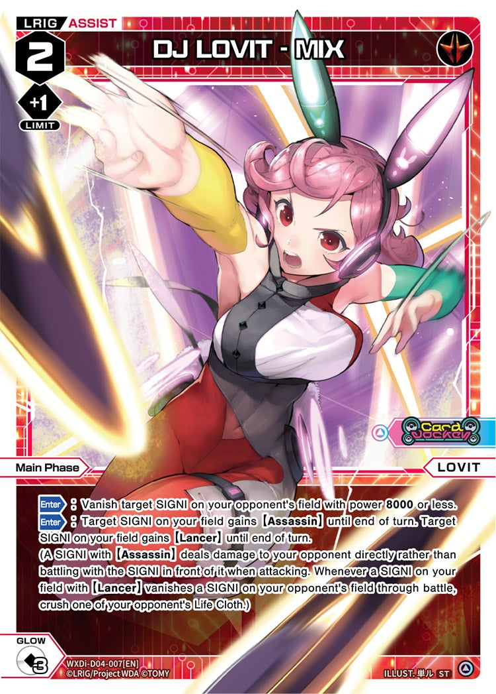

# DJ LOVIT - MIX

## Thông tin lá

| Trường | Giá trị |
| --- | --- |
| Mã in | WXDi-D04-007[EN] |
| Set | WXDi-D04[EN] |
| Loại thẻ | ASSIST LRIG |
| Vị trí | LRIG Deck |
| Số bản D04 | 1 |
| Màu | Đỏ |
| Độ hiếm | ST |
| Minh họa | 単ル |
| Level | 2 |
| Limit | ＋１ |
| Power | 0 |
| LRIG type / Class | LOVIT |
| Team / Master | Card Jockey |
| Cost | — |
| Grow cost | 《C》×３ |
| Use timing | Main Phase |
| Life Burst | Không |

## Card text chính thức

[Enter]: Vanish target SIGNI on your opponent's field with power 8000 or less.
[Enter]: Target SIGNI on your field gains 【Assassin】 until end of turn. Target SIGNI on your field gains 【Lancer】 until end of turn.
(A SIGNI with 【Assassin】 deals damage to your opponent directly rather than battling with the SIGNI in front of it when attacking. Whenever a SIGNI on your field with 【Lancer】 vanishes a SIGNI on your opponent's field through battle, crush one of your opponent's Life Cloth.)

## Power text / Life Burst

—

## Ghi chú minh họa
Artist: 単ル. Ảnh ST được tải từ Card List tiếng Anh.

## FAQ chính thức

— (không có FAQ riêng cho mã này trên trang FAQ tiếng Anh.)

## Nguồn
[Card List/FAQ chính thức](https://www.takaratomy.co.jp/products/en.wixoss/card/card.html?card_no=WXDi-D04-007%5BEN%5D ) · [Ảnh thẻ](https://www.takaratomy.co.jp/products/en.wixoss/card/thumb/WXDi-D04-007%5BEN%5D.jpg)
