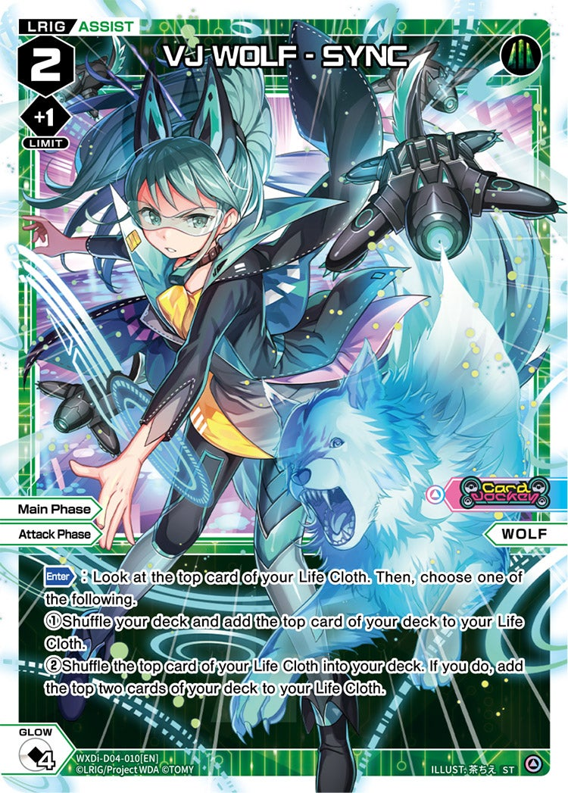

# VJ WOLF - SYNC

## Thông tin lá

| Trường | Giá trị |
| --- | --- |
| Mã in | WXDi-D04-010[EN] |
| Set | WXDi-D04[EN] |
| Loại thẻ | ASSIST LRIG |
| Vị trí | LRIG Deck |
| Số bản D04 | 1 |
| Màu | Xanh lá |
| Độ hiếm | ST |
| Minh họa | 茶ちえ |
| Level | 2 |
| Limit | ＋１ |
| Power | 0 |
| LRIG type / Class | WOLF |
| Team / Master | Card Jockey |
| Cost | — |
| Grow cost | 《C》×４ |
| Use timing | Main Phase / Attack Phase |
| Life Burst | Không |

## Card text chính thức

[Enter]: Look at the top card of your Life Cloth. Then, choose one of the following.
①Shuffle your deck and add the top card of your deck to your Life Cloth.
②Shuffle the top card of your Life Cloth into your deck. If you do, add the top two cards of your deck to your Life Cloth.

## Power text / Life Burst

—

## Ghi chú minh họa
Artist: 茶ちえ. Ảnh ST được tải từ Card List tiếng Anh.

## FAQ chính thức

**Q. How will [Enter] be prosecced if I don't have any life cloth?**
A. If you choose ①, you can add a life cloth.
In case of ②, you cannot shuffle the top card of your Life Cloth into your deck. So, you cannot process the effect after if you do.

## Nguồn
[Card List/FAQ chính thức](https://www.takaratomy.co.jp/products/en.wixoss/card/card.html?card_no=WXDi-D04-010%5BEN%5D ) · [Ảnh thẻ](https://www.takaratomy.co.jp/products/en.wixoss/card/thumb/WXDi-D04-010%5BEN%5D.jpg)
