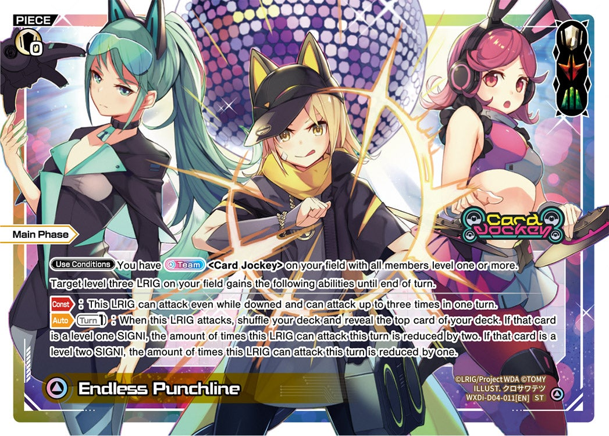

# Endless Punchline

## Thông tin lá

| Trường | Giá trị |
| --- | --- |
| Mã in | WXDi-D04-011[EN] |
| Set | WXDi-D04[EN] |
| Loại thẻ | PIECE |
| Vị trí | LRIG Deck |
| Số bản D04 | 1 |
| Màu | Trắng / đỏ / xanh lá |
| Độ hiếm | ST,DiR |
| Minh họa | クロサワテツ |
| Level | — |
| Limit | — |
| Power | 0 |
| LRIG type / Class | — |
| Team / Master | — |
| Cost | 《W》×０ |
| Grow cost | — |
| Use timing | Main Phase |
| Life Burst | Không |

## Card text chính thức

[Use Conditions] You have [Team] <Card Jockey> on your field with all members level one or more.

Target level three LRIG on your field gains the following abilities until end of turn.
『[Constant]: This LRIG can attack even while downed and can attack up to three times in one turn.
[Auto] {1/Turn}: When this LRIG attacks, shuffle your deck and reveal the top card of your deck. If that card is a level one SIGNI, the amount of times this LRIG can attack this turn is reduced by two. If that card is a level two SIGNI, the amount of times this LRIG can attack this turn is reduced by one.』

## Power text / Life Burst

—

## Ghi chú minh họa
Artist: クロサワテツ. Ảnh ST được tải từ Card List tiếng Anh.

## FAQ chính thức

**Q. When I use this piece, how many times can my LRIG attack as a result?**
A. Maximum three times. Detils are below.
On the first attack , shuffle your deck and reveal the top one.
If it is a level 1 SIGNI, that attack only ends.
If it is a level 2 SIGNI, you can attack again.
If it is a level 3 SIGNI or spell, the maximum number of attacks is not reduced, and you can attack a total of three times.

**Q. A level 1 SIGNI was released and the maximum number of attacks was reduced to 1. If the LRIG is then Upped by some effect, can I attack again?**
A. No, you can't. Even if it is Upped, the maximum number of attacks possible is limited to one due to the effect of the PIECE used.

## Ảnh biến thể

- [DiR](../images/WXDi-D04-011D-EN.jpg)

## Nguồn
[Card List/FAQ chính thức](https://www.takaratomy.co.jp/products/en.wixoss/card/card.html?card_no=WXDi-D04-011%5BEN%5D ) · [Ảnh thẻ](https://www.takaratomy.co.jp/products/en.wixoss/card/thumb/WXDi-D04-011%5BEN%5D.jpg)
