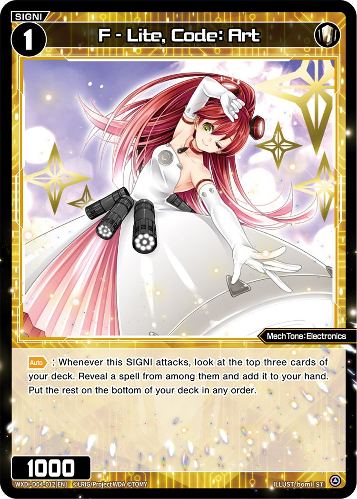

# F - Lite, Code: Art

## Thông tin lá

| Trường | Giá trị |
| --- | --- |
| Mã in | WXDi-D04-012[EN] |
| Set | WXDi-D04[EN] |
| Loại thẻ | SIGNI |
| Vị trí | Main Deck |
| Số bản D04 | 4 |
| Màu | Trắng |
| Độ hiếm | ST |
| Minh họa | bomi |
| Level | 1 |
| Limit | — |
| Power | 1000 |
| LRIG type / Class | Mech Tone：Electronics |
| Team / Master | — |
| Cost | — |
| Grow cost | — |
| Use timing | — |
| Life Burst | Không |

## Card text chính thức

[Auto]: Whenever this SIGNI attacks, look at the top three cards of your deck. Reveal a spell from among them and add it to your hand. Put the rest on the bottom of your deck in any order.

## Power text / Life Burst

—

## Ghi chú minh họa
Artist: bomi. Ảnh ST được tải từ Card List tiếng Anh.

## FAQ chính thức

— (không có FAQ riêng cho mã này trên trang FAQ tiếng Anh.)

## Nguồn
[Card List/FAQ chính thức](https://www.takaratomy.co.jp/products/en.wixoss/card/card.html?card_no=WXDi-D04-012%5BEN%5D ) · [Ảnh thẻ](https://www.takaratomy.co.jp/products/en.wixoss/card/thumb/WXDi-D04-012%5BEN%5D.jpg)
