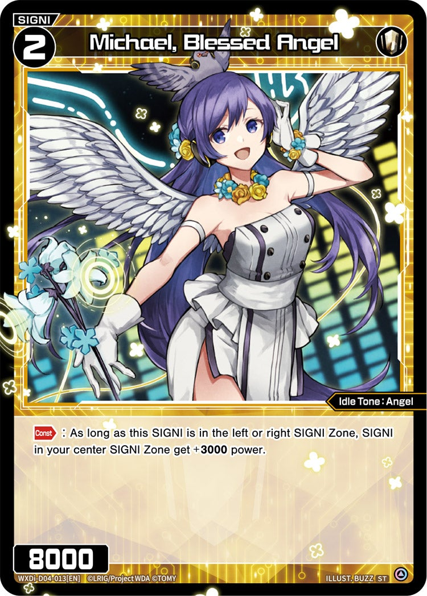

# Michael, Blessed Angel

## Thông tin lá

| Trường | Giá trị |
| --- | --- |
| Mã in | WXDi-D04-013[EN] |
| Set | WXDi-D04[EN] |
| Loại thẻ | SIGNI |
| Vị trí | Main Deck |
| Số bản D04 | 4 |
| Màu | Trắng |
| Độ hiếm | ST |
| Minh họa | BUZZ |
| Level | 2 |
| Limit | — |
| Power | 8000 |
| LRIG type / Class | Idol Tone：Angel |
| Team / Master | — |
| Cost | — |
| Grow cost | — |
| Use timing | — |
| Life Burst | Không |

## Card text chính thức

[Constant]: As long as this SIGNI is in the left or right SIGNI Zone, SIGNI in your center SIGNI Zone get +3000 power.

## Power text / Life Burst

—

## Ghi chú minh họa
Artist: BUZZ. Ảnh ST được tải từ Card List tiếng Anh.

## FAQ chính thức

— (không có FAQ riêng cho mã này trên trang FAQ tiếng Anh.)

## Nguồn
[Card List/FAQ chính thức](https://www.takaratomy.co.jp/products/en.wixoss/card/card.html?card_no=WXDi-D04-013%5BEN%5D ) · [Ảnh thẻ](https://www.takaratomy.co.jp/products/en.wixoss/card/thumb/WXDi-D04-013%5BEN%5D.jpg)
