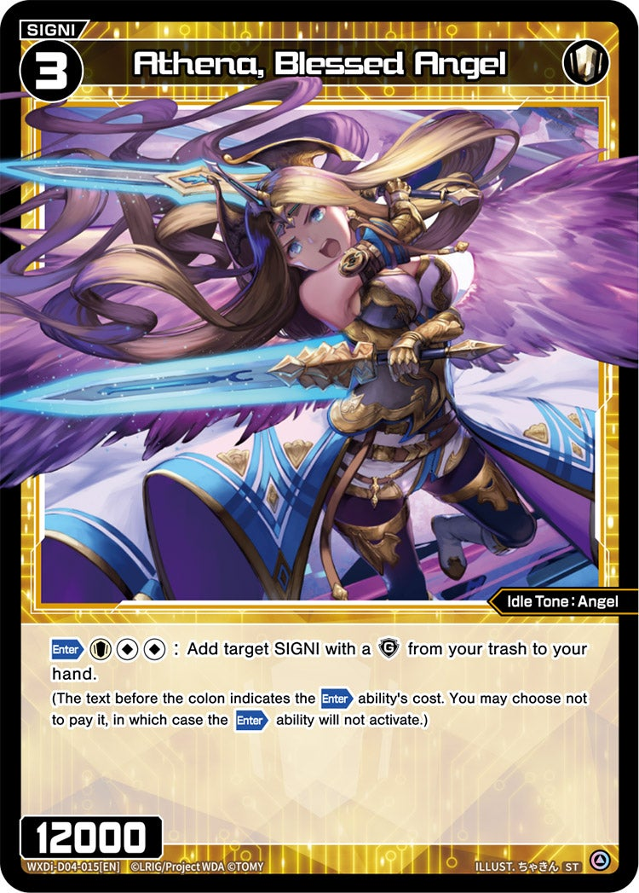

# Athena, Blessed Angel

## Thông tin lá

| Trường | Giá trị |
| --- | --- |
| Mã in | WXDi-D04-015[EN] |
| Set | WXDi-D04[EN] |
| Loại thẻ | SIGNI |
| Vị trí | Main Deck |
| Số bản D04 | 4 |
| Màu | Trắng |
| Độ hiếm | ST |
| Minh họa | ちゃきん |
| Level | 3 |
| Limit | — |
| Power | 12000 |
| LRIG type / Class | Idol Tone：Angel |
| Team / Master | — |
| Cost | — |
| Grow cost | — |
| Use timing | — |
| Life Burst | Không |

## Card text chính thức

[Enter] {White} {Colorless} {Colorless}: Add target SIGNI with a {Guard Icon} from your trash to your hand.
(The text before the colon indicates the [Enter] ability's cost. You may choose not to pay it, in which case the [Enter] ability will not activate.)

## Power text / Life Burst

—

## Ghi chú minh họa
Artist: ちゃきん. Ảnh ST được tải từ Card List tiếng Anh.

## FAQ chính thức

**Q. Can I add a card I paid as Ener Cost of [Enter] to my hand by its effect?**
A. Yes, you can. You pay the cost and then target it, so if it is a SIGNI that meets the condition, it will be targeted and added to your hand.

## Nguồn
[Card List/FAQ chính thức](https://www.takaratomy.co.jp/products/en.wixoss/card/card.html?card_no=WXDi-D04-015%5BEN%5D ) · [Ảnh thẻ](https://www.takaratomy.co.jp/products/en.wixoss/card/thumb/WXDi-D04-015%5BEN%5D.jpg)
