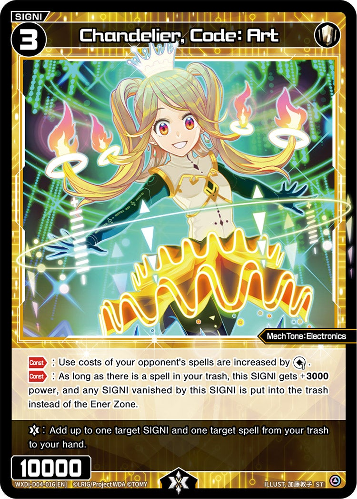

# Chandelier, Code: Art

## Thông tin lá

| Trường | Giá trị |
| --- | --- |
| Mã in | WXDi-D04-016[EN] |
| Set | WXDi-D04[EN] |
| Loại thẻ | SIGNI |
| Vị trí | Main Deck |
| Số bản D04 | 4 |
| Màu | Trắng |
| Độ hiếm | ST |
| Minh họa | 加藤敦子 |
| Level | 3 |
| Limit | — |
| Power | 10000 |
| LRIG type / Class | Mech Tone：Electronics |
| Team / Master | — |
| Cost | — |
| Grow cost | — |
| Use timing | — |
| Life Burst | Có |

## Card text chính thức

[Constant]: Use costs of your opponent's spells are increased by {Colorlessx1}.
[Constant]: As long as there is a spell in your trash, this SIGNI gets +3000 power, and any SIGNI vanished by this SIGNI is put into the trash instead of the Ener Zone.

## Power text / Life Burst

Add up to one target SIGNI and one target spell from your trash to your hand.

## Ghi chú minh họa
Artist: 加藤敦子. Ảnh ST được tải từ Card List tiếng Anh.

## FAQ chính thức

**Q. This SIGNI vanishes your opponent's SIGNI, and it is placed into the trash. If this SIGNI in the trash has [Auto] with when this SIGNI is vanished , does it trigger?**
A. Yes, it does. This [Auto] only changes the location of the vanished SIGNI, it does not change the fact that it was vanished. When this SIGNI is vanished will be triggered.

## Nguồn
[Card List/FAQ chính thức](https://www.takaratomy.co.jp/products/en.wixoss/card/card.html?card_no=WXDi-D04-016%5BEN%5D ) · [Ảnh thẻ](https://www.takaratomy.co.jp/products/en.wixoss/card/thumb/WXDi-D04-016%5BEN%5D.jpg)
