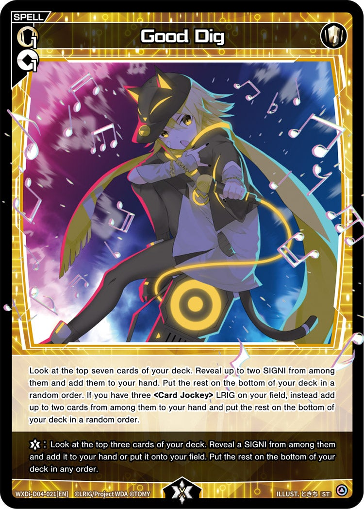

# Good Dig

## Thông tin lá

| Trường | Giá trị |
| --- | --- |
| Mã in | WXDi-D04-021[EN] |
| Set | WXDi-D04[EN] |
| Loại thẻ | SPELL |
| Vị trí | Main Deck |
| Số bản D04 | 4 |
| Màu | Trắng |
| Độ hiếm | ST |
| Minh họa | ときち |
| Level | — |
| Limit | — |
| Power | 0 |
| LRIG type / Class | — |
| Team / Master | — |
| Cost | 《W》×１
《C》×１ |
| Grow cost | — |
| Use timing | — |
| Life Burst | Có |

## Card text chính thức

Look at the top seven cards of your deck. Reveal up to two SIGNI from among them and add them to your hand. Put the rest on the bottom of your deck in a random order. If you have three <Card Jockey> LRIG on your field, instead add up to two cards from among them to your hand and put the rest on the bottom of your deck in a random order.

## Power text / Life Burst

Look at the top three cards of your deck. Reveal a SIGNI from among them and add it to your hand or put it onto your field. Put the rest on the bottom of your deck in any order.

## Ghi chú minh họa
Artist: ときち. Ảnh ST được tải từ Card List tiếng Anh.

## FAQ chính thức

**Q. If I have three LRIGs of <Card Jockey>, can I add them to my hand without revealing them?**
A. Yes, you can add up to two cards to your hand without revealing them if you meet the requirement. (You can dig two spells secretly, if you want.)

**Q. I used this spell when I had less than 6 cards in my deck. What happens?**
A. In that case, the effect is processed by looking at all remaining decks with 6 or less cards. If you eventually return one or more cards to the deck, no refresh is performed.

## Nguồn
[Card List/FAQ chính thức](https://www.takaratomy.co.jp/products/en.wixoss/card/card.html?card_no=WXDi-D04-021%5BEN%5D ) · [Ảnh thẻ](https://www.takaratomy.co.jp/products/en.wixoss/card/thumb/WXDi-D04-021%5BEN%5D.jpg)
