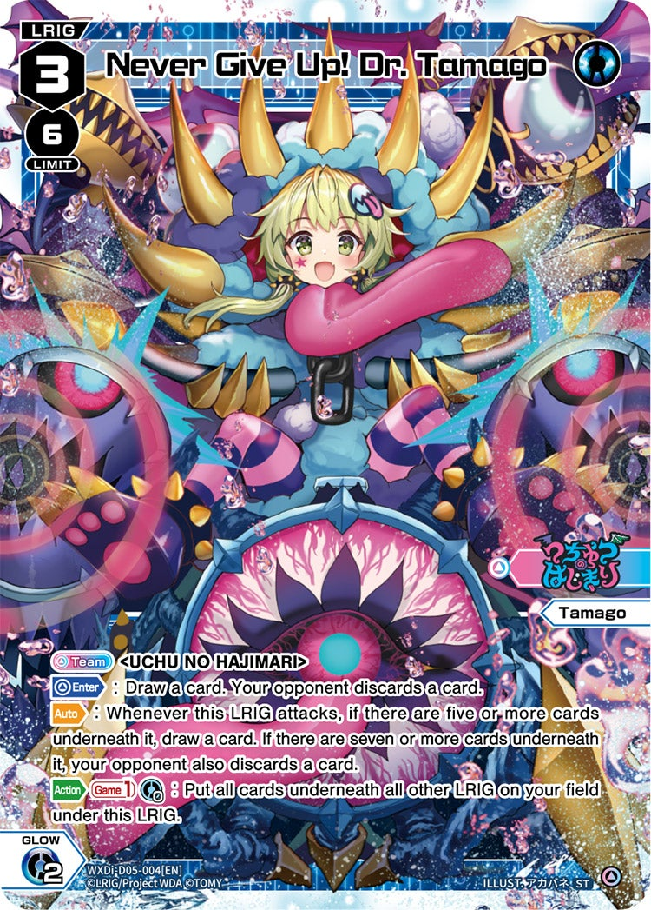

# Never Give Up! Dr. Tamago

## Thông tin lá

| Trường | Giá trị |
| --- | --- |
| Mã in | WXDi-D05-004[EN] |
| Set | WXDi-D05[EN] |
| Loại thẻ | LRIG |
| Vị trí | LRIG Deck |
| Số bản D05 | 1 |
| Màu | Xanh dương |
| Độ hiếm | ST,SCR,DiR |
| Minh họa | アカバネ |
| Level | 3 |
| Limit | 6 |
| Power | 0 |
| LRIG type / Class | Tamago |
| Team / Master | UCHU NO HAJIMARI |
| Cost | — |
| Grow cost | 《U》×２ |
| Use timing | — |
| Life Burst | Không |

## Card text chính thức

[Team] <UCHU NO HAJIMARI>
[Team Enter]: Draw a card. Your opponent discards a card.
[Auto]: Whenever this LRIG attacks, if there are five or more cards underneath it, draw a card. If there are seven or more cards underneath it, your opponent also discards a card.
[Action] {1/Game} {Bluex0}: Put all cards underneath all other LRIG on your field under this LRIG.

## Power text / Life Burst

—

## Ghi chú minh họa
Artist: アカバネ. Ảnh ST được tải từ Card List tiếng Anh.

## FAQ chính thức

**Q. What does it mean by [Team]?**
A. It means the team indicated by that card. The [Team Auto], [Team Action], [Team Constant], and [Team Enter] abilities of the card are valid only if all 3 LRIGs in your field are the indicated [Team].
In the case of this card, if all three of your LRIGs are <UCHU NO HAJIMARI>, you will be able to use the [Team Enter] ability.

**Q. Is it possible to not use the [Team Enter] ability?**
A. No, [Enter] ability with no cost (described before:) is compulsory. Even if you don't want to use the effect, you must use the effect on it.

## Ảnh biến thể

- [SCR](../images/WXDi-D05-004S-EN.jpg)
- [DiR](../images/WXDi-D05-004D-EN.jpg)

## Nguồn
[Card List/FAQ chính thức](https://www.takaratomy.co.jp/products/en.wixoss/card/card.html?card_no=WXDi-D05-004%5BEN%5D ) · [Ảnh thẻ](https://www.takaratomy.co.jp/products/en.wixoss/card/thumb/WXDi-D05-004%5BEN%5D.jpg)
