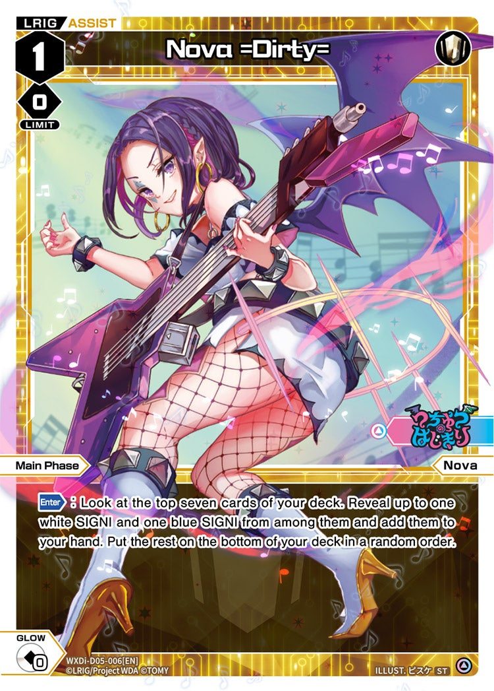

# Nova =Dirty=

## Thông tin lá

| Trường | Giá trị |
| --- | --- |
| Mã in | WXDi-D05-006[EN] |
| Set | WXDi-D05[EN] |
| Loại thẻ | ASSIST LRIG |
| Vị trí | LRIG Deck |
| Số bản D05 | 1 |
| Màu | Trắng |
| Độ hiếm | ST |
| Minh họa | ピスケ |
| Level | 1 |
| Limit | 0 |
| Power | 0 |
| LRIG type / Class | Nova |
| Team / Master | UCHU NO HAJIMARI |
| Cost | — |
| Grow cost | 《C》×０ |
| Use timing | Main Phase |
| Life Burst | Không |

## Card text chính thức

[Enter]: Look at the top seven cards of your deck. Reveal up to one white SIGNI and one blue SIGNI from among them and add them to your hand. Put the rest on the bottom of your deck in a random order.

## Power text / Life Burst

—

## Ghi chú minh họa
Artist: ピスケ. Ảnh ST được tải từ Card List tiếng Anh.

## FAQ chính thức

— (không có FAQ riêng cho mã này trên trang FAQ tiếng Anh.)

## Nguồn
[Card List/FAQ chính thức](https://www.takaratomy.co.jp/products/en.wixoss/card/card.html?card_no=WXDi-D05-006%5BEN%5D ) · [Ảnh thẻ](https://www.takaratomy.co.jp/products/en.wixoss/card/thumb/WXDi-D05-006%5BEN%5D.jpg)
