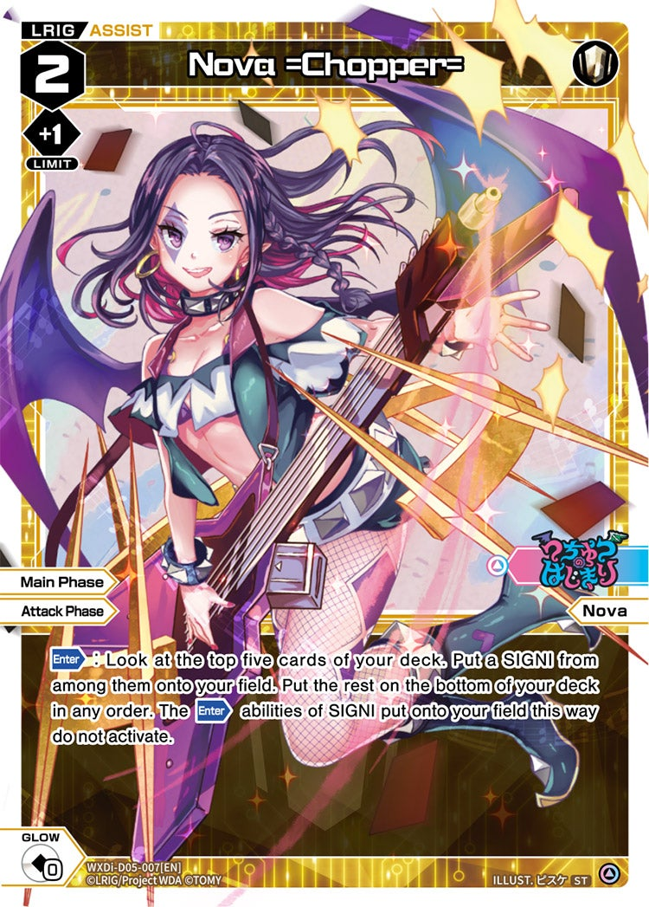

# Nova =Chopper=

## Thông tin lá

| Trường | Giá trị |
| --- | --- |
| Mã in | WXDi-D05-007[EN] |
| Set | WXDi-D05[EN] |
| Loại thẻ | ASSIST LRIG |
| Vị trí | LRIG Deck |
| Số bản D05 | 1 |
| Màu | Trắng |
| Độ hiếm | ST |
| Minh họa | ピスケ |
| Level | 2 |
| Limit | ＋１ |
| Power | 0 |
| LRIG type / Class | Nova |
| Team / Master | UCHU NO HAJIMARI |
| Cost | — |
| Grow cost | 《C》×０ |
| Use timing | Main Phase / Attack Phase |
| Life Burst | Không |

## Card text chính thức

[Enter]: Look at the top five cards of your deck. Put a SIGNI from among them onto your field. Put the rest on the bottom of your deck in any order. The [Enter] abilities of SIGNI put onto your field this way do not activate.

## Power text / Life Burst

—

## Ghi chú minh họa
Artist: ピスケ. Ảnh ST được tải từ Card List tiếng Anh.

## FAQ chính thức

— (không có FAQ riêng cho mã này trên trang FAQ tiếng Anh.)

## Nguồn
[Card List/FAQ chính thức](https://www.takaratomy.co.jp/products/en.wixoss/card/card.html?card_no=WXDi-D05-007%5BEN%5D ) · [Ảnh thẻ](https://www.takaratomy.co.jp/products/en.wixoss/card/thumb/WXDi-D05-007%5BEN%5D.jpg)
