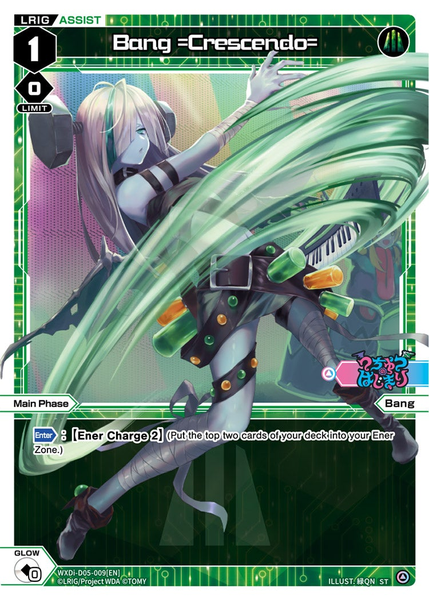

# Bang =Crescendo=

## Thông tin lá

| Trường | Giá trị |
| --- | --- |
| Mã in | WXDi-D05-009[EN] |
| Set | WXDi-D05[EN] |
| Loại thẻ | ASSIST LRIG |
| Vị trí | LRIG Deck |
| Số bản D05 | 1 |
| Màu | Xanh lá |
| Độ hiếm | ST |
| Minh họa | 緑QN |
| Level | 1 |
| Limit | 0 |
| Power | 0 |
| LRIG type / Class | Bang |
| Team / Master | UCHU NO HAJIMARI |
| Cost | — |
| Grow cost | 《C》×０ |
| Use timing | Main Phase |
| Life Burst | Không |

## Card text chính thức

[Enter]: 【Ener Charge 2】 (Put the top two cards of your deck into your Ener Zone.)

## Power text / Life Burst

—

## Ghi chú minh họa
Artist: 緑QN. Ảnh ST được tải từ Card List tiếng Anh.

## FAQ chính thức

**Q. Is it possible to not use the [Enter] ability?**
A. No, [Enter] ability with no cost (described before:) is compulsory. Even if you don't want to use the effect, you must use the effect on it.

## Nguồn
[Card List/FAQ chính thức](https://www.takaratomy.co.jp/products/en.wixoss/card/card.html?card_no=WXDi-D05-009%5BEN%5D ) · [Ảnh thẻ](https://www.takaratomy.co.jp/products/en.wixoss/card/thumb/WXDi-D05-009%5BEN%5D.jpg)
