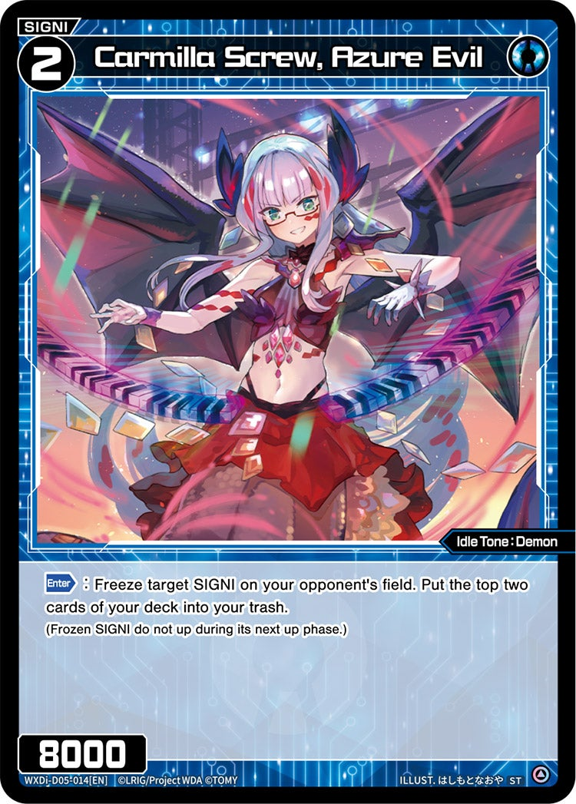

# Carmilla Screw, Azure Evil

## Thông tin lá

| Trường | Giá trị |
| --- | --- |
| Mã in | WXDi-D05-014[EN] |
| Set | WXDi-D05[EN] |
| Loại thẻ | SIGNI |
| Vị trí | Main Deck |
| Số bản D05 | 4 |
| Màu | Xanh dương |
| Độ hiếm | ST |
| Minh họa | はしもとなおや |
| Level | 2 |
| Limit | — |
| Power | 8000 |
| LRIG type / Class | Idol Tone：Demon |
| Team / Master | — |
| Cost | — |
| Grow cost | — |
| Use timing | — |
| Life Burst | Không |

## Card text chính thức

[Enter]: Freeze target SIGNI on your opponent's field. Put the top two cards of your deck into your trash.
(Frozen SIGNI do not up during its next up phase.)

## Power text / Life Burst

—

## Ghi chú minh họa
Artist: はしもとなおや. Ảnh ST được tải từ Card List tiếng Anh.

## FAQ chính thức

**Q. Can I target upped SIGNI？**
A. Yes, you can. In that case, it will be frozen, but will not be downed. If that SIGNI becomes downed before the next up phase, it will not be upped due to frozen.

**Q. Does the effect of putting a card into the trash take place even if there is no SIGNI that can be targeted?**
A. Yes, the second half of the process will be performed even if the appropriate target is not present.

**Q. Is it possible to not use the [Enter] ability?**
A. No, [Enter] ability with no cost (described before:) is compulsory. Even if you don't want to use the effect, if there is a target that fits the condition, you must use the effect on it. And with or without the target, you must also perform the following effect: Put the top two cards~.

## Nguồn
[Card List/FAQ chính thức](https://www.takaratomy.co.jp/products/en.wixoss/card/card.html?card_no=WXDi-D05-014%5BEN%5D ) · [Ảnh thẻ](https://www.takaratomy.co.jp/products/en.wixoss/card/thumb/WXDi-D05-014%5BEN%5D.jpg)
