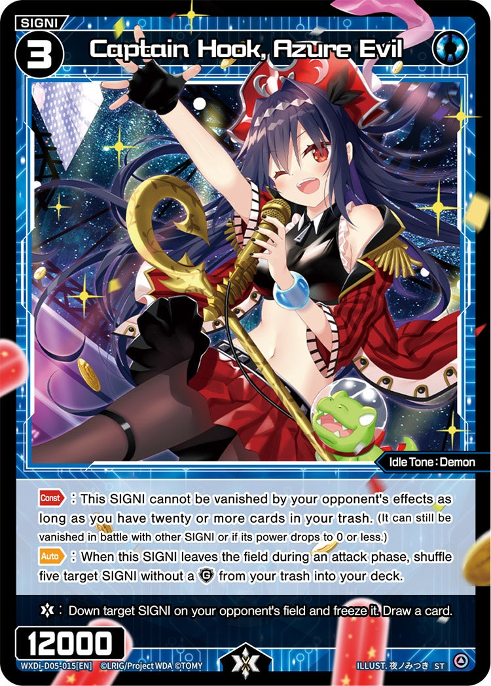

# Captain Hook, Azure Evil

## Thông tin lá

| Trường | Giá trị |
| --- | --- |
| Mã in | WXDi-D05-015[EN] |
| Set | WXDi-D05[EN] |
| Loại thẻ | SIGNI |
| Vị trí | Main Deck |
| Số bản D05 | 4 |
| Màu | Xanh dương |
| Độ hiếm | ST |
| Minh họa | 夜ノみつき |
| Level | 3 |
| Limit | — |
| Power | 12000 |
| LRIG type / Class | Idol Tone：Demon |
| Team / Master | — |
| Cost | — |
| Grow cost | — |
| Use timing | — |
| Life Burst | Có |

## Card text chính thức

[Constant]: This SIGNI cannot be vanished by your opponent's effects as long as you have twenty or more cards in your trash. (It can still be vanished in battle with other SIGNI or if its power drops to 0 or less.)
[Auto]: When this SIGNI leaves the field during an attack phase, shuffle five target SIGNI without a {Guard Icon} from your trash into your deck.

## Power text / Life Burst

Down target SIGNI on your opponent's field and freeze it. Draw a card.

## Ghi chú minh họa
Artist: 夜ノみつき. Ảnh ST được tải từ Card List tiếng Anh.

## FAQ chính thức

**Q. When this [Constant] is enabled, will this SIGNI be placed in the Ener Zone by the Put target SIGNI~into Ener Zone. effect of Creation Tone etc.?**
A. Yes, it will be placed. The Put target SIGNI~into Ener Zone. effect is distinct from Vanish. This cannot be prevented by [Constant].

**Q. When [Auto] was activated, there were only 4 SIGNI cards in my trash. Can I add those 4 cards to the deck as targets and shuffle them?**
A. No, you can't. It doesn't say up to, so it has to target the specified numbers. In this case, there are only 4 or less cards, so you can't target any of them.

## Nguồn
[Card List/FAQ chính thức](https://www.takaratomy.co.jp/products/en.wixoss/card/card.html?card_no=WXDi-D05-015%5BEN%5D ) · [Ảnh thẻ](https://www.takaratomy.co.jp/products/en.wixoss/card/thumb/WXDi-D05-015%5BEN%5D.jpg)
