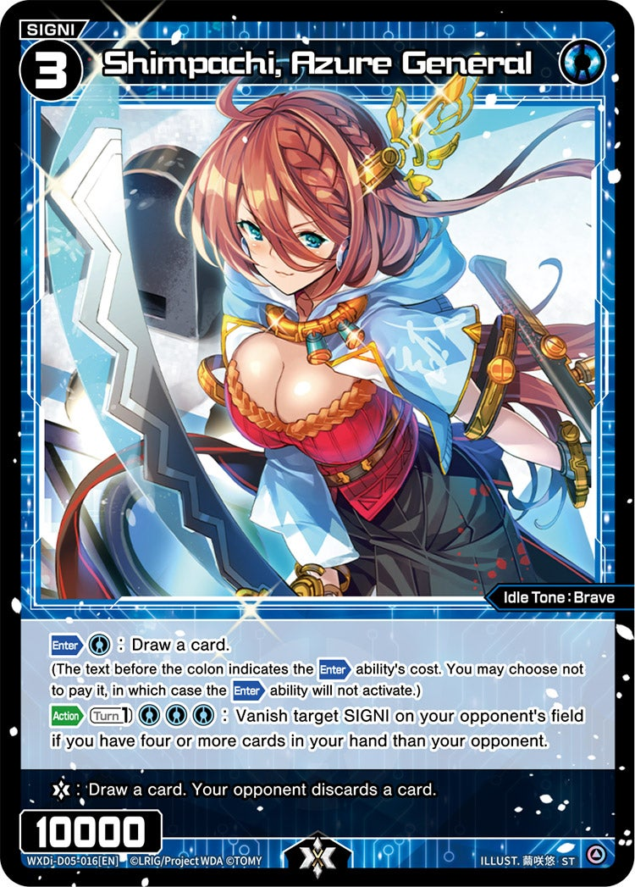

# Shimpachi, Azure General

## Thông tin lá

| Trường | Giá trị |
| --- | --- |
| Mã in | WXDi-D05-016[EN] |
| Set | WXDi-D05[EN] |
| Loại thẻ | SIGNI |
| Vị trí | Main Deck |
| Số bản D05 | 4 |
| Màu | Xanh dương |
| Độ hiếm | ST |
| Minh họa | 繭咲悠 |
| Level | 3 |
| Limit | — |
| Power | 10000 |
| LRIG type / Class | Idol Tone：Brave |
| Team / Master | — |
| Cost | — |
| Grow cost | — |
| Use timing | — |
| Life Burst | Có |

## Card text chính thức

[Enter] {Blue}: Draw a card.
(The text before the colon indicates the [Enter] ability's cost. You may choose not to pay it, in which case the [Enter] ability will not activate.)
[Action] {1/Turn} {Blue} {Blue} {Blue}: Vanish target SIGNI on your opponent's field if you have four or more cards in your hand than your opponent.

## Power text / Life Burst

Draw a card. Your opponent discards a card.

## Ghi chú minh họa
Artist: 繭咲悠. Ảnh ST được tải từ Card List tiếng Anh.

## FAQ chính thức

— (không có FAQ riêng cho mã này trên trang FAQ tiếng Anh.)

## Nguồn
[Card List/FAQ chính thức](https://www.takaratomy.co.jp/products/en.wixoss/card/card.html?card_no=WXDi-D05-016%5BEN%5D ) · [Ảnh thẻ](https://www.takaratomy.co.jp/products/en.wixoss/card/thumb/WXDi-D05-016%5BEN%5D.jpg)
