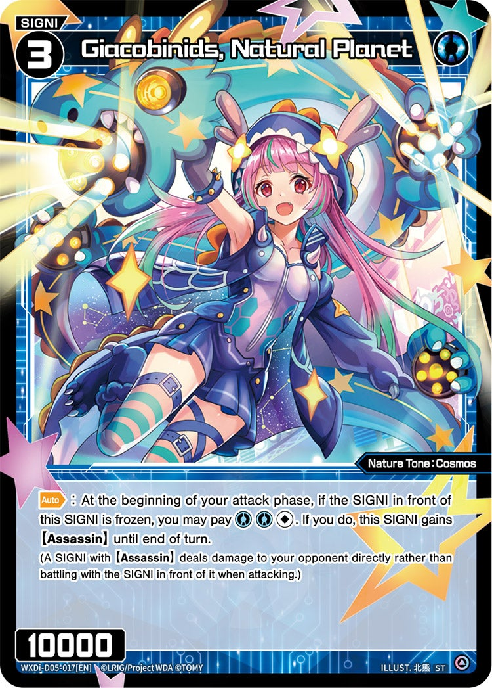

# Giacobinids, Natural Planet

## Thông tin lá

| Trường | Giá trị |
| --- | --- |
| Mã in | WXDi-D05-017[EN] |
| Set | WXDi-D05[EN] |
| Loại thẻ | SIGNI |
| Vị trí | Main Deck |
| Số bản D05 | 4 |
| Màu | Xanh dương |
| Độ hiếm | ST |
| Minh họa | 北熊 |
| Level | 3 |
| Limit | — |
| Power | 10000 |
| LRIG type / Class | Nature Tone：Cosmos |
| Team / Master | — |
| Cost | — |
| Grow cost | — |
| Use timing | — |
| Life Burst | Không |

## Card text chính thức

[Auto]: At the beginning of your attack phase, if the SIGNI in front of this SIGNI is frozen, you may pay {Blue} {Blue} {Colorless}. If you do, this SIGNI gains 【Assassin】 until end of turn.
(A SIGNI with 【Assassin】 deals damage to your opponent directly rather than battling with the SIGNI in front of it when attacking.)

## Power text / Life Burst

—

## Ghi chú minh họa
Artist: 北熊. Ảnh ST được tải từ Card List tiếng Anh.

## FAQ chính thức

— (không có FAQ riêng cho mã này trên trang FAQ tiếng Anh.)

## Nguồn
[Card List/FAQ chính thức](https://www.takaratomy.co.jp/products/en.wixoss/card/card.html?card_no=WXDi-D05-017%5BEN%5D ) · [Ảnh thẻ](https://www.takaratomy.co.jp/products/en.wixoss/card/thumb/WXDi-D05-017%5BEN%5D.jpg)
