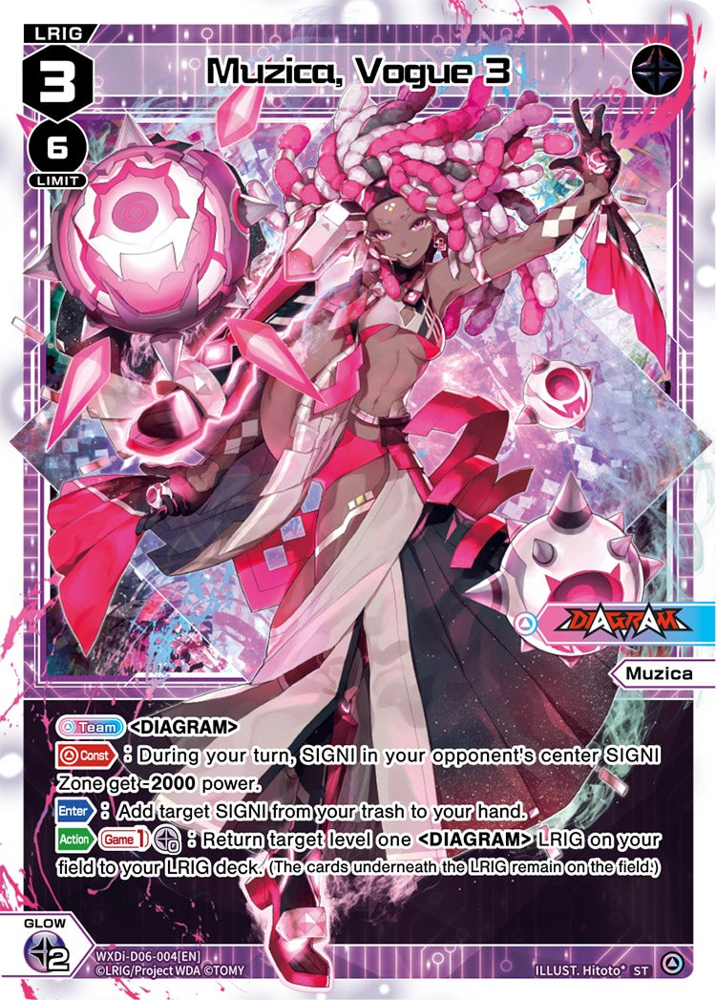

# Muzica, Vogue 3

## Thông tin lá

| Trường | Giá trị |
| --- | --- |
| Mã in | WXDi-D06-004[EN] |
| Set | WXDi-D06[EN] |
| Loại thẻ | LRIG |
| Vị trí | LRIG Deck |
| Số bản D06 | 1 |
| Màu | Đen |
| Độ hiếm | ST,SCR,DiR |
| Minh họa | Hitoto* |
| Level | 3 |
| Limit | 6 |
| Power | 0 |
| LRIG type / Class | Muzica |
| Team / Master | DIAGRAM |
| Cost | — |
| Grow cost | 《B》×２ |
| Use timing | — |
| Life Burst | Không |

## Card text chính thức

[Team] <DIAGRAM>
[Team Constant]: During your turn, SIGNI in your opponent's center SIGNI Zone get -2000 power.
[Enter]: Add target SIGNI from your trash to your hand.
[Action] {1/Game} {Blackx0}: Return target level one <DIAGRAM> LRIG on your field to your LRIG deck. (The cards underneath the LRIG remain on the field.)

## Power text / Life Burst

—

## Ghi chú minh họa
Artist: Hitoto*. Ảnh ST được tải từ Card List tiếng Anh.

## FAQ chính thức

**Q. What does it mean by [Team]?**
A. It means the team indicated by that card. The [Team Auto], [Team Action], [Team Constant], and [Team Enter] abilities of the card are valid only if all 3 LRIGs in your field are the indicated [Team].
In the case of this card, if all three of your LRIGs are <DIAGRAM>, you will be able to use the [Team Constant] ability.

**Q. What happens if [Team Constant] is active and my opponent places a SIGNI of 2000 power or less in the center SIGNI zone?**
A. The SIGNI's power is reduced to 0 or less and it is vanish by Rule-based action. If the SIGNI has [Enter] ability, it will be activated after vanished.

**Q. Can I re-grow a level 1 LRIG that was returned by [Action]?**
A. Yes, it can be grown again if it can be grown properly from a level 0 LRIG.

**Q. In [Action], can I put back into the LRIG deck the LRIGs that are already level 2 in the DIAGRAM, but only the level 1 ones underneath?**
A. No, this [Action] can only target the LRIG placed on the top.

## Ảnh biến thể

- [SCR](../images/WXDi-D06-004S-EN.jpg)
- [DiR](../images/WXDi-D06-004D-EN.jpg)

## Nguồn
[Card List/FAQ chính thức](https://www.takaratomy.co.jp/products/en.wixoss/card/card.html?card_no=WXDi-D06-004%5BEN%5D ) · [Ảnh thẻ](https://www.takaratomy.co.jp/products/en.wixoss/card/thumb/WXDi-D06-004%5BEN%5D.jpg)
