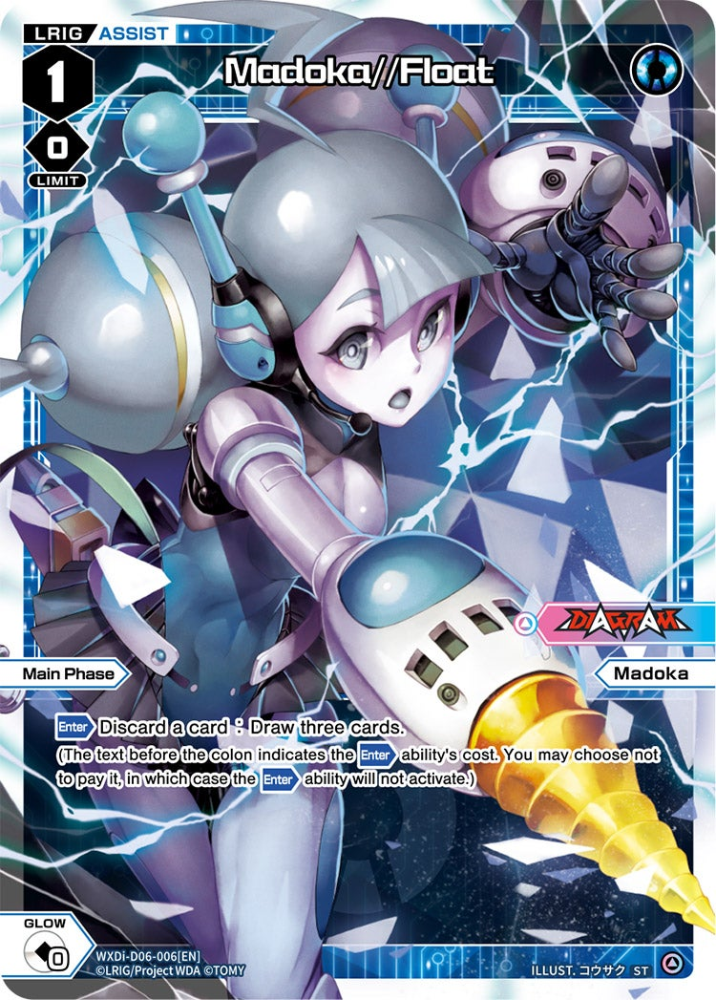

# Madoka//Float

## Thông tin lá

| Trường | Giá trị |
| --- | --- |
| Mã in | WXDi-D06-006[EN] |
| Set | WXDi-D06[EN] |
| Loại thẻ | ASSIST LRIG |
| Vị trí | LRIG Deck |
| Số bản D06 | 1 |
| Màu | Xanh dương |
| Độ hiếm | ST |
| Minh họa | コウサク |
| Level | 1 |
| Limit | 0 |
| Power | 0 |
| LRIG type / Class | Madoka |
| Team / Master | DIAGRAM |
| Cost | — |
| Grow cost | 《C》×０ |
| Use timing | Main Phase |
| Life Burst | Không |

## Card text chính thức

[Enter] Discard a card: Draw three cards.
(The text before the colon indicates the [Enter] ability's cost. You may choose not to pay it, in which case the [Enter] ability will not activate.)

## Power text / Life Burst

—

## Ghi chú minh họa
Artist: コウサク. Ảnh ST được tải từ Card List tiếng Anh.

## FAQ chính thức

— (không có FAQ riêng cho mã này trên trang FAQ tiếng Anh.)

## Nguồn
[Card List/FAQ chính thức](https://www.takaratomy.co.jp/products/en.wixoss/card/card.html?card_no=WXDi-D06-006%5BEN%5D ) · [Ảnh thẻ](https://www.takaratomy.co.jp/products/en.wixoss/card/thumb/WXDi-D06-006%5BEN%5D.jpg)
