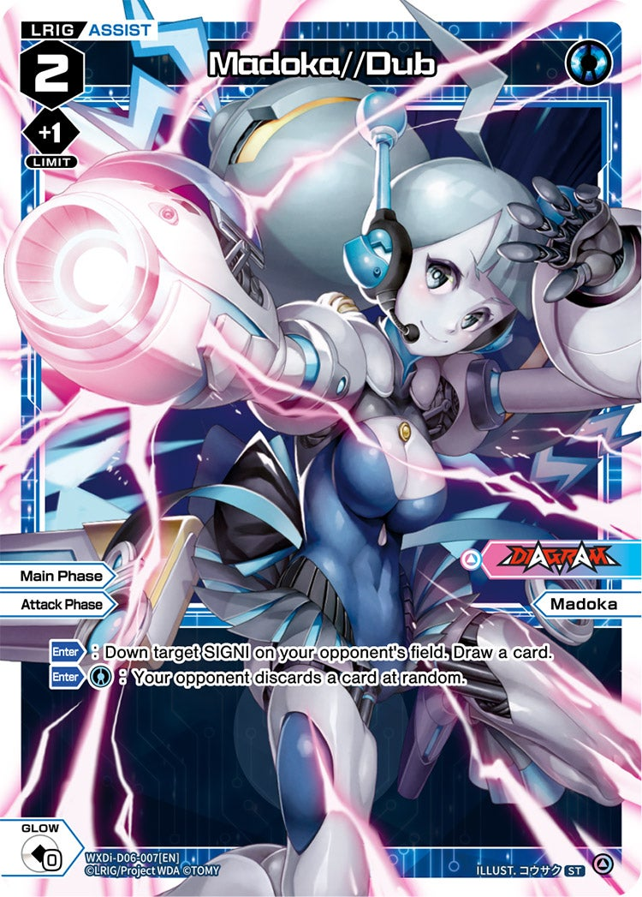

# Madoka//Dub

## Thông tin lá

| Trường | Giá trị |
| --- | --- |
| Mã in | WXDi-D06-007[EN] |
| Set | WXDi-D06[EN] |
| Loại thẻ | ASSIST LRIG |
| Vị trí | LRIG Deck |
| Số bản D06 | 1 |
| Màu | Xanh dương |
| Độ hiếm | ST |
| Minh họa | コウサク |
| Level | 2 |
| Limit | ＋１ |
| Power | 0 |
| LRIG type / Class | Madoka |
| Team / Master | DIAGRAM |
| Cost | — |
| Grow cost | 《C》×０ |
| Use timing | Main Phase / Attack Phase |
| Life Burst | Không |

## Card text chính thức

[Enter]: Down target SIGNI on your opponent's field. Draw a card.
[Enter] {Blue}: Your opponent discards a card at random.

## Power text / Life Burst

—

## Ghi chú minh họa
Artist: コウサク. Ảnh ST được tải từ Card List tiếng Anh.

## FAQ chính thức

**Q. With [Enter] above, can I draw a card even if my opponent has no SIGNI?**
A. Yes, you can.

## Nguồn
[Card List/FAQ chính thức](https://www.takaratomy.co.jp/products/en.wixoss/card/card.html?card_no=WXDi-D06-007%5BEN%5D ) · [Ảnh thẻ](https://www.takaratomy.co.jp/products/en.wixoss/card/thumb/WXDi-D06-007%5BEN%5D.jpg)
