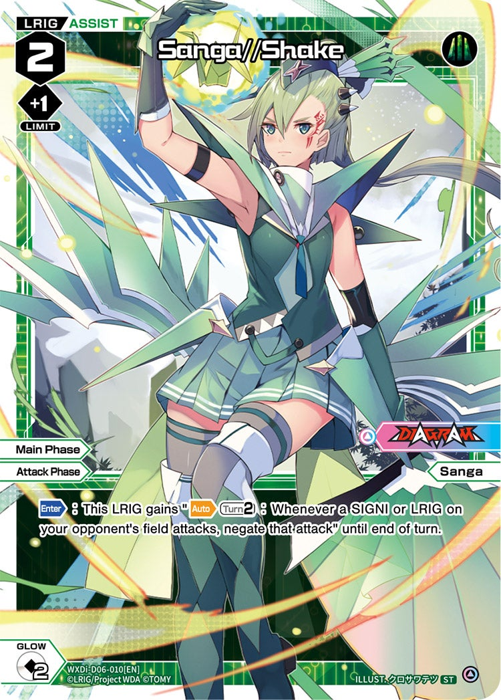

# Sanga//Shake

## Thông tin lá

| Trường | Giá trị |
| --- | --- |
| Mã in | WXDi-D06-010[EN] |
| Set | WXDi-D06[EN] |
| Loại thẻ | ASSIST LRIG |
| Vị trí | LRIG Deck |
| Số bản D06 | 1 |
| Màu | Xanh lá |
| Độ hiếm | ST |
| Minh họa | クロサワテツ |
| Level | 2 |
| Limit | ＋１ |
| Power | 0 |
| LRIG type / Class | Sanga |
| Team / Master | DIAGRAM |
| Cost | — |
| Grow cost | 《C》×２ |
| Use timing | Main Phase / Attack Phase |
| Life Burst | Không |

## Card text chính thức

[Enter]: This LRIG gains "[Auto] {2/Turn}: Whenever a SIGNI or LRIG on your opponent's field attacks, negate that attack" until end of turn.

## Power text / Life Burst

—

## Ghi chú minh họa
Artist: クロサワテツ. Ảnh ST được tải từ Card List tiếng Anh.

## FAQ chính thức

**Q. When this card negates the attack of SIGNI or LRIG, what happens if they have an ability that triggers when they attack?**
A. Regardless of whether or not the effect of 《SSanga//Shake》 is present, [Auto] that is triggered by attacking will be processed.

**Q. When this card negates the attack of SIGNI or LRIG, what happens if they have an ability that triggers when they attack?**
A. Negated SIGNI's [Auto] will be triggered. When the "negate" effect is processed on SIGNI or LRIG, they are no longer "attacking". Therefore, they will not battle the SIGNI in front of them. They also do not deal any damage to the opponent. However, the record that the SIGNI or LRIG's attack are kept, so the effects triggered by the attack will still be triggered.

## Nguồn
[Card List/FAQ chính thức](https://www.takaratomy.co.jp/products/en.wixoss/card/card.html?card_no=WXDi-D06-010%5BEN%5D ) · [Ảnh thẻ](https://www.takaratomy.co.jp/products/en.wixoss/card/thumb/WXDi-D06-010%5BEN%5D.jpg)
