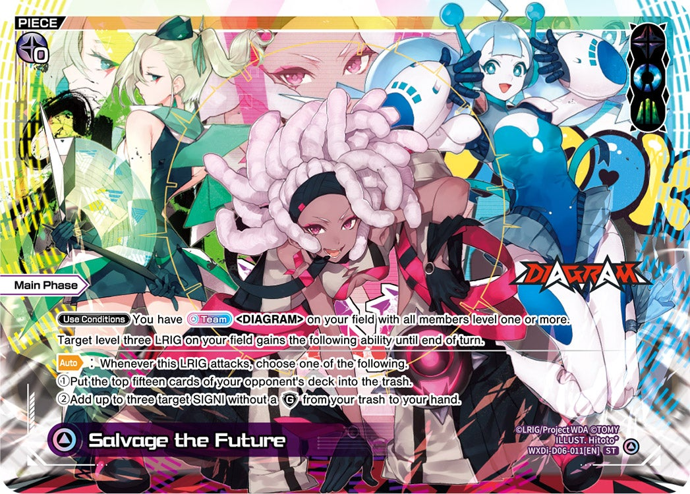

# Salvage the Future

## Thông tin lá

| Trường | Giá trị |
| --- | --- |
| Mã in | WXDi-D06-011[EN] |
| Set | WXDi-D06[EN] |
| Loại thẻ | PIECE |
| Vị trí | LRIG Deck |
| Số bản D06 | 1 |
| Màu | Đen / xanh dương / xanh lá |
| Độ hiếm | ST,DiR |
| Minh họa | Hitoto* |
| Level | — |
| Limit | — |
| Power | 0 |
| LRIG type / Class | — |
| Team / Master | — |
| Cost | 《B》×０ |
| Grow cost | — |
| Use timing | Main Phase |
| Life Burst | Không |

## Card text chính thức

[Use Conditions] You have [Team] <DIAGRAM> on your field with all members level one or more.

Target level three LRIG on your field gains the following ability until end of turn.
『[Auto]: Whenever this LRIG attacks, choose one of the following.
①Put the top fifteen cards of your opponent's deck into the trash.
②Add up to three target SIGNI without a {Guard Icon} from your trash to your hand.』

## Power text / Life Burst

—

## Ghi chú minh họa
Artist: Hitoto*. Ảnh ST được tải từ Card List tiếng Anh.

## FAQ chính thức

— (không có FAQ riêng cho mã này trên trang FAQ tiếng Anh.)

## Ảnh biến thể

- [DiR](../images/WXDi-D06-011D-EN.jpg)

## Nguồn
[Card List/FAQ chính thức](https://www.takaratomy.co.jp/products/en.wixoss/card/card.html?card_no=WXDi-D06-011%5BEN%5D ) · [Ảnh thẻ](https://www.takaratomy.co.jp/products/en.wixoss/card/thumb/WXDi-D06-011%5BEN%5D.jpg)
