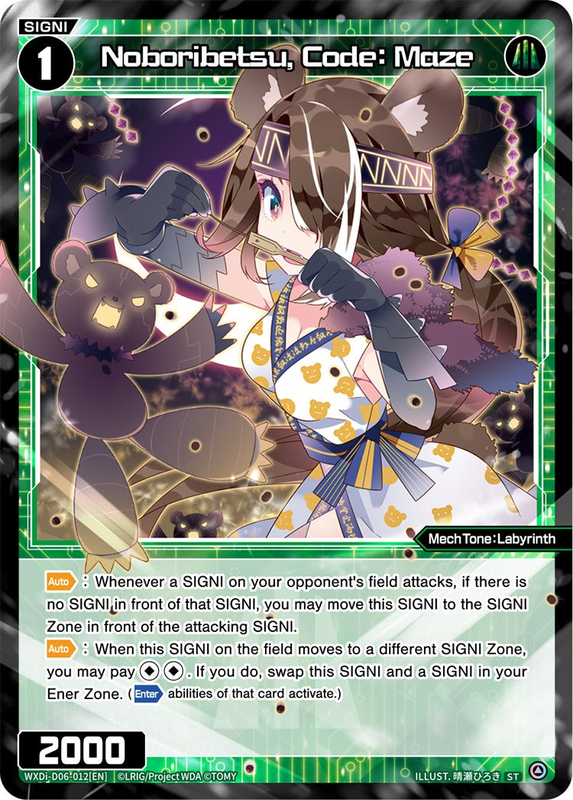

# Noboribetsu, Code: Maze

## Thông tin lá

| Trường | Giá trị |
| --- | --- |
| Mã in | WXDi-D06-012[EN] |
| Set | WXDi-D06[EN] |
| Loại thẻ | SIGNI |
| Vị trí | Main Deck |
| Số bản D06 | 4 |
| Màu | Xanh lá |
| Độ hiếm | ST |
| Minh họa | 晴瀬ひろき |
| Level | 1 |
| Limit | — |
| Power | 2000 |
| LRIG type / Class | Mech Tone：Labyrinth |
| Team / Master | — |
| Cost | — |
| Grow cost | — |
| Use timing | — |
| Life Burst | Không |

## Card text chính thức

[Auto]: Whenever a SIGNI on your opponent's field attacks, if there is no SIGNI in front of that SIGNI, you may move this SIGNI to the SIGNI Zone in front of the attacking SIGNI.
[Auto]: When this SIGNI on the field moves to a different SIGNI Zone, you may pay {Colorless} {Colorless}. If you do, swap this SIGNI and a SIGNI in your Ener Zone. ([Enter] abilities of that card activate.)

## Power text / Life Burst

—

## Ghi chú minh họa
Artist: 晴瀬ひろき. Ảnh ST được tải từ Card List tiếng Anh.

## FAQ chính thức

**Q. If the upper [Auto] is triggered and this SIGNI is placed in front of the attacking SIGNI, will the lower [Auto] also be triggered?**
A. Yes, it will be triggered. If the [Auto] below also triggers and replaces the SIGNI in the Ener Zone, then that SIGNI's [Enter] also triggers, followed by a battle with the attacking SIGNI in front of it.

## Nguồn
[Card List/FAQ chính thức](https://www.takaratomy.co.jp/products/en.wixoss/card/card.html?card_no=WXDi-D06-012%5BEN%5D ) · [Ảnh thẻ](https://www.takaratomy.co.jp/products/en.wixoss/card/thumb/WXDi-D06-012%5BEN%5D.jpg)
